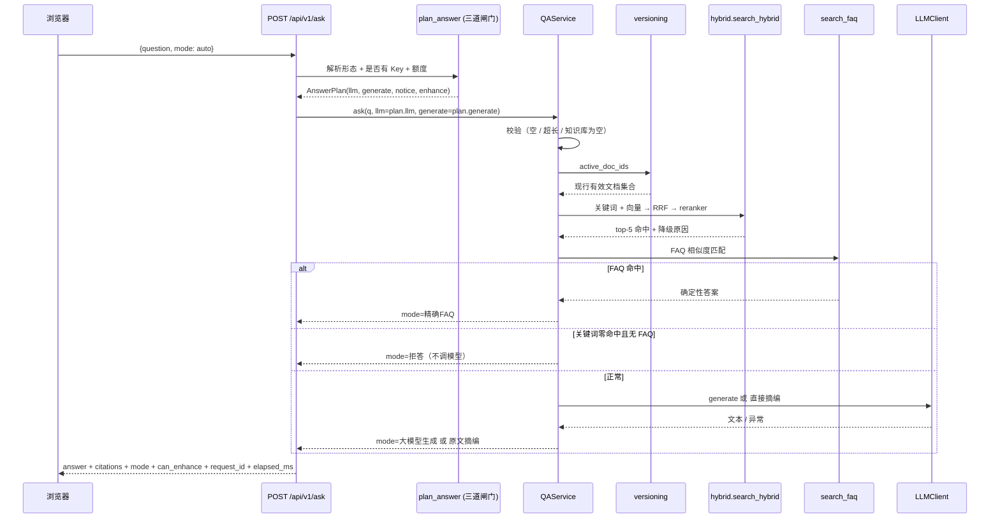

# 校园知识问答系统 · 项目产品报告与交接手册

| 项 | 值 |
|---|---|
| 文档性质 | 产品报告 + 工程交接手册（同一份，供人阅读，也供其它智能体直接接管项目） |
| 代码基线 | 提交 `7f404d9` · tag `v0.6.0` · `app/__init__.py` 中 `__version__ = "0.6.0"` |
| 生成时间 | 2026-11-04 |
| 事实来源 | 本文件所有数字均来自**当次实测**（`app.cli stats`、`pytest --collect-only`、SQLite 查询、代码阅读），非估计值。凡属推断或外部知识，单独标注 `[待核实]` |

---

## 目录

- [0. 怎么读这份文档](#0-怎么读这份文档)
- [1. 一页速览](#1-一页速览)
- [2. 产品定义](#2-产品定义)
- [3. 系统架构](#3-系统架构)
- [4. 数据层](#4-数据层)
- [5. 检索与问答链路](#5-检索与问答链路)
- [6. 大模型层](#6-大模型层)
- [7. 部署形态与成本控制](#7-部署形态与成本控制)
- [8. API 契约](#8-api-契约)
- [9. 前端](#9-前端)
- [10. 配置矩阵](#10-配置矩阵)
- [11. 运行与验证](#11-运行与验证)
- [12. 质量现状](#12-质量现状)
- [13. 已知缺陷与技术债](#13-已知缺陷与技术债)
- [14. 接手须知（给下一个智能体）](#14-接手须知给下一个智能体)
- [15. 路线图](#15-路线图)
- [附录 A 术语表](#附录-a-术语表)
- [附录 B 文件清单](#附录-b-文件清单)
- [附录 C 变更历史](#附录-c-变更历史)

---

## 0. 怎么读这份文档

三类读者，三种读法：

| 你是谁 | 读这几节 | 需要多久 |
|---|---|---|
| 想了解这个产品做了什么、值不值得看 | §1、§2、§12 | 8 分钟 |
| 要改代码 / 做技术评审 | §3 → §5 → §6 → §7 → §8 → §13 → §14 | 40 分钟 |
| **下一个接手的智能体** | §14 全节，再按需回查 §4/§8/§11 | 先读 §14 |

**信息可信度分级**（全文遵守）：

- 「实测」= 本次运行命令 / 查询数据库得到的真实输出。
- 「代码」= 直接读源码可确认，附文件与行号。
- `[待核实: 方式]` = 依赖外部信息（第三方 API 价格、模型上限等），本文不臆断。

**一句话结论**：这是一个**已经能跑、能测、能部署，但尚未发布到公网**的单校制度问答系统。它的差异化不在「用了 GraphRAG」这个词，而在**回答必须带条款出处、找不到就拒答、以及零成本原文摘编兜底**这三件事被真正做成了默认行为。

---

## 1. 一页速览

### 1.1 它是什么

一个面向**单所高校**的制度 / 通知问答系统：学生问「奖学金怎么申请」「补考有什么规定」，系统从学生手册与校方通知中检索条款，给出**带出处**的回答；资料里没有的内容明确拒答，不编造。

与通用大模型问答的关键差别：

| 维度 | 通用大模型 | 本项目 |
|---|---|---|
| 依据 | 训练数据里的「一般性知识」 | 本校 8 份文件 / 827 条条款，逐条可溯源 |
| 找不到时 | 倾向于编一个像样的答案 | 明确拒答并给出咨询部门建议 |
| 成本 | 每次问答都花钱 | **默认零成本**（原文摘编），大模型是按需增强 |
| 时效 | 不知道文件是否已废止 | 按「现行有效 + 已生效 + 未被替代」过滤 |

### 1.2 关键数字（本次实测）

| 指标 | 数值 | 来源 |
|---|---|---|
| 源文件 | 8（手册 1 + 通知 7） | `python -m app.cli stats` |
| 条款/段落块 | 827 | 同上 |
| 主题分类 | 5 | 同上 |
| 实体节点 | 82（部门 6 / 流程 10 / 领域实体 66） | 同上 |
| 关系 | 81（跨分类 26） | 同上 |
| FAQ 问答组 | 16 | 同上 |
| 自测题 | 22 | 同上 |
| 向量条数 | 827（与条款一一对应） | SQLite `vector_index` |
| 评测集 | 55 题 | `data/evaluation.json` |
| Recall@5 | **0.8909**（最近一次，2026-09-16）；历史最好 0.9000（2026-09-08） | `evaluation_runs` 表 |
| 事实一致性（近似） | 0.6894 | 同上 |
| 引用覆盖率 | 1.0 | 同上 |
| 自动化测试 | 118 项（117 通过 + 1 跳过） | `pytest --collect-only -q` |
| 后端代码 | 6,539 行 Python（37 个文件） | `find app -name "*.py"` 后 `wc -l` |
| 前端代码 | 2,438 行（10 个 JS + 1 HTML + 1 CSS，无构建） | `wc -l frontend/js/*.js frontend/index.html frontend/css/*.css` |
| 测试代码 | 2,067 行 | `wc -l tests/*.py` |
| 设计文档 | 1,353 行（8 份 Markdown，含索引） | `find docs -name "*.md"` 后 `wc -l` |

### 1.3 三条命令跑起来（Windows 实测）

```bash
# 在仓库根目录
pip install -r requirements.txt

# 首次：导入知识库（含向量构建，本机约 18 秒）
python -m app.cli import

# 启动后端（首次问答要加载 BGE 模型，冷启动 59~69 秒）
python -m app.cli serve --host 127.0.0.1 --port 8000
```

前端二选一：

```bash
# A. 独立静态服务（开发/演示，禁用缓存，推荐）
python scripts/frontend_server.py --port 5500
# 浏览器打开 http://127.0.0.1:5500/?api=http://127.0.0.1:8000#chat

# B. Docker（前后端一起，nginx 托管前端 + 反代 /api）
docker compose up -d --build
# 前端 http://localhost:8080 ，后端 http://localhost:8000
```

> **前提**：`data/raw/` 下需存在 8 个原始文件。从 GitHub 克隆的仓库**只有其中 6 个**（2 个 PDF 因校方版权未分发），`python -m app.cli import` 会因缺文件直接报错。补齐方法见 §11.1。

### 1.4 当前状态（截至 2026-11-20，`v0.6.0`）

| 项 | 状态 |
|---|---|
| 工作区 | 干净（`git status` 无改动） |
| 本地 / 远端 `main` | `7f404d9`，已同步（`ahead 0 / behind 0`） |
| 开发分支 | `codex/campus-qa-improvements` = `7f404d9`，与 `main` 同点 |
| tag | `v0.6.0` 已在远端（annotated → `7f404d9`） |
| 测试 | 全量 GREEN：117 passed / 1 skipped（共 118 项） |
| CI | 双平台工作流只覆盖语料无关的 6 条（§11.4）；118 项全量只能在本地跑（需语料 + BGE 模型） |
| 部署形态 | 默认 `public`（不采集用户密钥、默认原文摘编） |
| 身份模型 | 仅 `student` 可自助注册；`teacher` / `admin` 只能由管理员注入（`v0.6.0` 起） |

---

## 2. 产品定义

### 2.1 要解决的现实问题

高校制度信息有三层摩擦：

1. **找不到**：制度散落在学生手册（几十页 PDF）、学工处通知、学院细则里，学生不知道该翻哪一份。
2. **找不到最新版**：2024 年的奖学金通知与 2025 年的并存，前者已失效但仍在流传。
3. **不敢信 AI**：通用大模型能给出「看起来对」的答案，但校园事务一旦答错（金额、比例、时限、受理部门），代价是学生跑错窗口、错过申报期。

本项目的产品判断是：**在制度问答这种场景，"可溯源"比"答得流畅"重要一个数量级**。因此所有设计都向「出处可见、无据不答」倾斜。

### 2.2 目标用户与三个使用场景

| 角色 | 场景 | 系统提供的价值 |
|---|---|---|
| 学生（主要） | 申报奖学金前查条件与比例；挂科后查补考/重修规则 | 直接问，答案附条款原文，可自己核对 |
| 学生（学习） | 考前自测校规、标记未掌握知识点 | 22 道题库 + 错题集 + 掌握标记，答错的知识点在后续问答中提示复习 |
| 教师 / 管理员 | 新增一份通知，希望它立刻可被检索 | 调 `POST /ingest/notice`，自动切块、建向量、检测是否替代旧文件 |

### 2.3 产品定位与边界（重要，决定对外怎么讲）

**定位**：图谱增强的 RAG（Knowledge-Graph-Enhanced RAG），面向单校小规模垂直语料。

**必须讲清的三个边界**（对外表述与简历口径都要一致）：

1. **不含社区检测与社区摘要**。这不是微软 GraphRAG 的完整实现。本项目用知识图谱做的是：实体识别 → 子图展开 → 关系路径解释，用于**增强检索与可解释性**，不做全局社区摘要。叫「GraphRAG」是行业习惯用法，但技术答辩时必须主动说明差异，否则会被追问到答不上来。
2. **不迁移图数据库**。规模 82 节点 / 81 边，SQLite 三元组表 + 应用层 BFS 完全够用（实测递归 CTE 三跳 0.82ms、全图 BFS 0.50ms）。Neo4j 的收益区间在十万节点以上与需要 GDS 图算法库的场景，本项目不在此列。保持单库单事务，避免双写一致性问题。
3. **单校单租户**。一个部署实例服务一所学校的一套语料，不做多校隔离。

### 2.4 功能清单

| # | 功能 | 用户入口 | 后端实现 | 状态 |
|---|---|---|---|---|
| 1 | 单轮问答（带引用、拒答） | 智能问答页 | `POST /api/v1/ask` → `QAService.ask` | 可用 |
| 2 | 多轮会话 + 指代改写 | 智能问答页左侧会话栏 | `POST /sessions/{id}/ask` → `ConversationService.rewrite_question` | 可用 |
| 3 | 知识图谱浏览（节点搜索 / 邻居 / 子图 / 路径） | 知识图谱页 | `/graph/*` 6 个接口 | 可用 |
| 4 | 校规自测（抽题 / 判题 / 错题 / 统计） | 校规自测页 | `/quiz/*` 5 个接口 | 可用 |
| 5 | 掌握标记 + 问答内复习提示 | 掌握标记页 + 回答尾部 | `/mastery/*` 4 个接口 + `QAService._append_mastery_hint` | 可用 |
| 6 | 三路检索对比（关键词 / 向量 / 混合） | 检索对比页 | `GET /search/compare` | 可用 |
| 7 | 时效过滤与版本冲突提示 | 自动生效 | `versioning.active_doc_ids` / `check_conflict` | 可用 |
| 8 | 增量入库（教师上传通知） | 维护端 | `POST /ingest/notice` | 可用 |
| 9 | 质量评测（Recall@K 等） | 维护端 | `POST /evaluation/run` | 可用 |
| 10 | 多用户与角色权限 | 身份面板（右上角） | `/users`、`X-User-Token` | 可用 |
| 11 | 身份分档：学生自助 / 老师与管理员的名单注入 | 维护端「用户与名单」 | `POST /users/bulk` | 可用 |
| 12 | 用户自带大模型密钥（BYOK，旧路径） | 模型设置（仅 selfhost 显示） | `/llm/config` 4 个接口 | 可用，不再是主路径 |
| 13 | 聊天窗口模型选择（服务端默认 / 自定义模型） | 输入框下方 | `X-LLM-*` 请求头，密钥存浏览器 | 可用 |
| 14 | 管理员默认模型（改完即时生效） | 身份面板内隐藏入口 | `/llm/default` 3 个接口 | 可用 |
| 15 | 公开部署每日额度 | 自动生效 | `llm_quota.consume` | 可用 |
| 16 | Dify 外部知识库适配 | 无 UI | `POST /dify/retrieval`（配置 KEY 才注册） | 可用 |
| 17 | 备份 / 恢复 | CLI | `python -m app.backup backup|restore` | 可用 |

### 2.5 明确不做的事（避免被当成缺陷）

- 不做全文搜索框（检索只在问答链路内）。
- 不做用户注册体系（无密码、无邮箱；`POST /users` 直接发 token）。
- 不做流式输出（`stream: false`，一次返回）。
- 不做移动端适配（窄屏只是折行，无独立布局）。
- 不做多校 / 多租户。

---

## 3. 系统架构

### 3.1 四层解耦

```
┌────────────────────────────────────────────────────────────┐
│ Web 层    app/web/                                          │
│   server.py（40 个路由） deps.py（依赖注入） dify.py（适配）  │
├────────────────────────────────────────────────────────────┤
│ 服务层    app/service/                                       │
│   qa / conversation / llm / llm_config / llm_quota          │
│   graph / quiz / mastery / versioning / ingestion           │
│   evaluation / users / paths                                 │
├────────────────────────────────────────────────────────────┤
│ 检索层    app/retrieval/                                     │
│   tokenizer（jieba） search（关键词） vector（向量）          │
│   hybrid（RRF + reranker）                                   │
├────────────────────────────────────────────────────────────┤
│ 存储层    app/db.py（SQLite，17 张表）                        │
└────────────────────────────────────────────────────────────┘
```

分层收益是可验证的：`QAService` 不 import FastAPI，`search.py` 不 import QAService。改检索策略不需要动 Web 层；换 Web 框架不需要动检索。

### 3.2 一次问答请求的完整链路



### 3.3 组件表

| 模块 | 职责 | 关键文件 | 失败时怎么办 |
|---|---|---|---|
| 配置 | 读 `.env` + 环境变量，环境变量优先 | `app/config.py` | 非法值回落默认，不抛异常 |
| 错误体系 | 统一 `{code,message,detail,request_id}` | `app/errors.py` | — |
| 存储 | 连接池（每请求一连接）、Schema 初始化、WAL | `app/db.py` | 抛 `StorageUnavailable` → HTTP 503 |
| 解析 | PDF/docx/doc/txt → 条块（章/条切分或分段） | `app/ingest/parser.py` | 缺库或缺文件 → `ImportError_` 硬报错 |
| 导入 | 幂等写库（稳定 ID + `INSERT OR REPLACE`） | `app/ingest/importer.py` | 悬空关系 → 硬报错并列明细 |
| 关键词检索 | jieba 分词 + 可解释评分 | `app/retrieval/search.py` | 分词失败回退正则切分 |
| 向量检索 | 余弦相似度，维度不一致自动重建 | `app/retrieval/vector.py` | 抛异常 → hybrid 降级为关键词单路 |
| 融合 | RRF（k=60）+ 可选 BGE-reranker | `app/retrieval/hybrid.py` | reranker 不可用 → 保留 RRF 结果 |
| 问答编排 | 校验 / 检索 / FAQ / 拒答 / 引用 / 子图 | `app/service/qa.py` | 生成失败 → 降级为原文摘编 |
| 会话 | 新建/列表/历史/删除 + 指代改写 | `app/service/conversation.py` | 无 LLM → 启发式拼接上一轮问题 |
| 大模型 | OpenAI 兼容调用、重试、脱敏、ping | `app/service/llm.py` | 全部异常 → `LLMUnavailable` → 降级 |
| 密钥 | BYOK 存取、SSRF 校验、连通性测试 | `app/service/llm_config.py` | 解密失败视为未配置 |
| 加密 | Fernet（AES-128-CBC + HMAC-SHA256） | `app/crypto.py` | 主密钥变更 → 解密失败但服务不崩 |
| 额度 | 双闸门、按天分区、fail-closed | `app/service/llm_quota.py` | 统计异常 → 拒绝生成，退回摘编 |
| 依赖注入 | 应用级重资源 + 请求级身份 | `app/web/deps.py` | — |
| 日志 | 单行键值对，含 request_id | `app/logging_util.py` | — |
| 本地模型 | BGE Embedding + Reranker，惰性加载 + 单例 | `app/ml_local.py` | 不可用返回 None，调用方降级 |

### 3.4 五个关键架构决策

| # | 决策 | 被否掉的方案 | 理由 | 代价 |
|---|---|---|---|---|
| 1 | 单 SQLite，不迁图库 | Neo4j | 规模 82 节点，实测 BFS 0.5ms；避免双写一致性 | 十万节点以上不适用 |
| 2 | 默认原文摘编，大模型按需增强 | 默认调 LLM | 检索全本地零成本；摘编不会被幻觉改写条款 | 首答观感「朴素」 |
| 3 | 密钥加密落库 + 只在 selfhost 开放入口 | 公开站点收集 Key | 陌生访客粘贴 Key = 钓鱼页观感，转化杀手 | 多一套加解密与 SSRF 防护 |
| 4 | 额度 fail-closed | fail-open（统计坏了就放行） | 护栏失效时宁可答案朴素，也不能让账单失控 | 统计异常时用户体验下降 |
| 5 | 前端无构建（原生 JS + IIFE） | Vue/React + Vite | 部署即静态文件，nginx 直接托管；评审者能直接读 | 手工管理脚本顺序与缓存版本号 |

---

## 4. 数据层

### 4.1 存储选型

单一 SQLite 文件（`data/school_kb.db`），WAL 模式，每请求独立连接，写操作用 `threading.RLock` 保护。

**为什么不迁 Neo4j**（`app/db.py:12-17` 有原文）：82 节点 / 81 边的规模，递归 CTE 三跳 0.82ms、全图 BFS 0.50ms，性能不是瓶颈；而双写会引入「图库与关系库不一致」这一类难排查问题。这个结论在 `docs/校园知识问答系统_项目设计文档.md §0.3` 有完整实测依据。

### 4.2 表清单（17 张）

| 表 | 用途 | 关键字段 | 备注 |
|---|---|---|---|
| `categories` | 主题分类 | `name`, `description` | 5 条 |
| `entities` | 实体节点 | `eid`, `kind`(entity/department/process), `name`, `category` | 82 条 |
| `documents` | 源文件元数据 | `doc_id`, `title`, `publish_date`, `effective_date`, `status`, `version`, `applies_to`, `doc_type`, `content_hash` | 8 条 |
| `clauses` | 条款/段落块 | `doc_id`, `chapter`, `article_no`, `content`, `seq` | 827 条，检索基本单元 |
| `relations` | 关系三元组 | `src`, `rel`, `dst`, `note` | 81 条，端点必须是实体或文档 ID |
| `faq` | 问答对 | `qid`, `question`, `answer`, `category`, `source` | 16 条 |
| `quiz` | 自测题 | `qid`, `category`, `difficulty`, `options`(JSON), `answer`(下标), `explanation` | 22 条 |
| `import_log` | 导入记录 | `run_id`, `counts_json`, `ok` | 排障用 |
| `users` | 用户与 token | `user_id`, `username`, `role`, `api_token` | 角色：student/teacher/admin |
| `sessions` | 会话 | `session_id`, `user_id`, `title` | 按 user 隔离 |
| `messages` | 消息 | `session_id`, `role`, `content`, `citations`(JSON) | 级联删除 |
| `vector_index` | 条款向量 | `clause_id`, `dim`, `vector`(JSON) | 827 条 |
| `mastery` | 掌握标记 | `user_id`, `item_id`, `item_type`, `status` | 主键 (user, item) |
| `quiz_attempts` | 答题记录 | `qid`, `user_id`, `chosen`, `correct` | 错题集来源 |
| `evaluation_runs` | 评测历史 | `recall_at_k`, `factuality`, `citation_cov`, `report_json` | 已有 2 次 |
| `user_llm_configs` | BYOK 配置 | `user_id`, `api_key_enc`(密文), `key_hint`, `base_url`, `model`, `enabled` | 明文永不落库 |
| `llm_usage` | 生成额度计数 | `day`, `scope`(global/user), `subject`, `count` | 只记次数，不记问题内容 |

### 4.3 数据目录

```
data/
├── raw/
│   ├── manifest.json          # 8 条文档元数据（标题/分类/发文/日期/状态/版本/适用对象/切分模式）
│   ├── handbook/
│   │   └── 2025版学生手册.pdf           ← 校方版权，未随仓库分发
│   └── notices/                          ← 6 个文件已在仓库中（合规债，见 §13 D-03）
│       ├── 2024年奖学金评定通知.txt
│       ├── 2025年奖学金评定通知.txt
│       ├── 助学贷款还款救助暂行办法.docx
│       ├── 生源地助学贷款预申请办理流程.docx
│       ├── 家庭经济困难学生认定工作的通知.txt
│       ├── 家庭经济困难学生认定工作实施办法.docx
│       └── 计算机工程学院综测评分细则.pdf   ← 未随仓库分发
├── kg/
│   ├── categories.json
│   ├── entities.json
│   └── relations.json
├── faq.json                   # 16 组
├── quiz.json                  # 22 题
├── evaluation.json            # 55 题（question / relevant_docs / keywords）
└── school_kb.db               # 本地开发库，被 .gitignore 排除
```

### 4.4 导入链路与硬报错点

```
manifest.json ──► parser（PDF/docx/doc/txt → 条块）
                     │
                     ├─ .pdf  : pypdf 抽文本 → 按「第X章/第X条」切
                     ├─ .docx : python-docx → 按段落切
                     ├─ .doc  : Word COM 或 LibreOffice
                     └─ .txt  : 直接读
                     ▼
              clauses / documents（INSERT OR REPLACE，稳定 ID = source_path + content hash）
                     ▼
              kg/*.json → entities / relations / categories
                     ▼
              faq.json / quiz.json
                     ▼
              ensure_vector_index（补齐缺失向量；维度变化则全量重建）
```

**三个硬报错点**（不要试图「静默跳过」来绕过）：

| 位置 | 触发条件 | 行为 |
|---|---|---|
| `importer.py:74-75` | manifest 引用的文件不存在 | `ImportError_`：`缺少数据文件: <path>` |
| `importer.py:355` 附近 | 关系端点引用不到的实体/文档（悬空关系） | `ImportError_` 并列出明细 |
| `importer.py:91` | 缺 `python-docx` / `pypdf` | 明确提示 pip 安装 |

> 这解释了为什么 CI 不能跑完整测试：干净克隆缺 2 个 PDF → 导入必然失败 → 所有依赖 `imported_db` 夹具的用例全挂。参见 §13 D-04。

### 4.5 当前数据规模（实测）

```
源文件总数         : 8        （手册 1 / 通知 7）
条款/段落块        : 827
主题分类          : 5
实体节点          : 82       （部门 6 / 流程 10 / 领域实体 66）
关系             : 81       （跨分类 26）
FAQ 问答组        : 16
自测题           : 22
未入库文件         : 0
向量             : 827
最小规模校验（§5.2）：全部通过
```

---

## 5. 检索与问答链路

### 5.1 九步链路（`app/service/qa.py:136-237`）

1. **校验**：空 → `EmptyQuestionError`(400)；超 `MAX_QUESTION_LEN`(2000) → `QuestionTooLongError`(400)。
2. **空库检查**：`db.is_empty()` 为真 → 返回「知识库为空，请先导入」。
3. **时效过滤**：`versioning.active_doc_ids` 只保留「现行有效 + 已生效 + 未被替代」。
4. **混合检索**：关键词路 + 向量路 → RRF 融合 → 可选 BGE-reranker 重排，取 Top-5。
5. **FAQ 匹配**：`search_faq` 精确等值优先，其次关键词重合率。
6. **实体识别**：分词后精确匹配 + 子串匹配实体名，用于图遍历与答案标注。
7. **冲突检测**：命中文档若被新版本替代，返回提示文案。
8. **拒答判定**：关键词路零命中 **且** 无 FAQ 命中 → 直接拒答（不调模型）。
9. **生成或摘编**：FAQ 命中走确定性答案；否则按 `generate` 决定调模型还是原文摘编。

### 5.2 关键词路评分（`app/retrieval/search.py:104-144`）

| 命中类型 | 加分 |
|---|---|
| 关键词出现在条款正文 | +1 |
| 关键词出现在文档标题 | +0.5 |
| 关键词本身是实体名 | +2 |
| 关键词匹配「第X条」且条号一致 | +3 |
| 弱语义词（什么/怎么/如何…） | 不计分，仅参与并列排序 |

排序：`(-score, doc_id, -len(matched))`，取 Top-K。

**为什么可解释**：每个命中都记 `matched` 列表，前端「检索对比」页可以直接展示「为什么这条被召回」。

### 5.3 向量路

三级 embedder（`app/embeddings.py:122-139`），启动时按优先级选一次：

| 优先级 | 实现 | 维度 | 触发条件 |
|---|---|---|---|
| 1 | 本地 BGE `bge-small-zh-v1.5` | 512（实际向量长度） | 模型文件存在且 `USE_LOCAL_EMBEDDING != off` |
| 2 | OpenAI 兼容 Embedding API | 由 `EMBEDDING_DIM` 决定 | 配置了 `EMBEDDING_API_KEY` + `EMBEDDING_BASE_URL` |
| 3 | 字符 n-gram 哈希向量器 | `EMBEDDING_DIM`（默认 256） | 兜底，离线可复现 |

**维度重建逻辑**（`vector.py:51-86`）：若 `vector_index` 现有维度与当前 embedder 不一致，清空全表重建。这是从哈希向量器切到 BGE 时必须的，否则余弦相似度恒为 0（维度不同 `cosine_similarity` 直接返回 0.0）。

### 5.4 RRF 融合

```
score(d) = Σ_r 1 / (k + rank_r(d))     k = 60
```

只有一路命中时 RRF 依然成立（等价于该路排名），无需分支。去重指纹 = `doc_id|chapter|article_no|content_md5[:8]`。

**reranker**：`ml_local.rerank_local` 对 Top-K 候选重排；本地 `bge-reranker-base` 不可用时返回 `None`，调用方保留 RRF 结果。这是「可选增强」而非必需项。

### 5.5 FAQ 短路（`c531017` 起收敛为精确等值）

FAQ 命中后**直接返回预置答案，不调模型**，`mode = 精确FAQ`。设计意图是：高频问题给出确定性答案，省钱且稳定。

匹配规则（`search.py:152-162`）：

1. 去掉空白、标点、下划线后**完全相等**才算命中，不接受任何近似匹配。
2. 命中后还要过**证据闸门**（`qa.py:183-193`）：FAQ 的 `source` 必须能解析出《文档名》，该文档必须处于「现行有效」状态，并且用同一问题在该文档内**能检索到条款**。三者任一不满足，FAQ 作废，退回正常检索链路。

**为什么不做模糊匹配**：本系统的失效模式是「答非所问比降级更糟」——错答案看起来不像出错，用户不会追问。历史实现用过 `overlap = |Q∩F| / |F|`（分母只取 FAQ 侧，不是 Jaccard）阈值 0.5，实测把「国家励志奖学金的金额是多少？」错配给「国家奖学金和国家助学金有什么区别？」。现版本**直接取消模糊档**，代价是 FAQ 召回变严（换个问法就不命中），由条款检索 + 大模型兜底。16 条 FAQ 的规模下这个取舍划算；若 FAQ 涨到 100+ 再引入 Jaccard 近似档，阈值必须用评测集重新标定。修复前后对照见 §13 D-01。

### 5.6 拒答判据（`qa.py:203-204`）

```
if not comparison.keyword or not hits:  → 拒答
```

FAQ 命中的情况已在 §5.5 提前 `return`，走不到这里，所以拒答判据只看混合检索自身。注意这里是 **`or` 不是 `and`**：关键词路没命中，或者融合结果为空，任一成立就拒答——宁可说"没收录"，也不拿向量路的边缘命中硬答。

**为什么用关键词路而不是向量路判定**：离线哈希向量器对中文区分度有限，会把无关条款也召回（余弦 > 0 即入榜）。若用向量命中断言「知识库有资料」，会出现「明明没有却硬答」。这是刻意的保守选择。

拒答文案固定模板（`REFUSAL_TEMPLATE`），明确告知「不编造未收录内容」并建议咨询部门。

### 5.7 降级矩阵

| 故障 | 触发点 | 降级动作 | 用户可见提示 |
|---|---|---|---|
| 向量路异常 | `hybrid.search_hybrid` try/except | 退回关键词单路 | `degraded=true` + `degradation_notice`「语义检索暂不可用，已切换关键词模式。」 |
| reranker 不可用 | `rerank_hits` 返回 None | 保留 RRF 顺序 | 无（静默，属正常） |
| 无可用大模型密钥 | `plan_answer` | 原文摘编 | `mode=原文摘编` + `mode_notice` |
| 生成调用失败 | `qa._generate` except | 原文摘编 | `degraded=true` |
| 额度用尽 | `llm_quota.consume` | 原文摘编 | `mode_notice` 给出额度说明 |
| 额度统计异常 | `consume` except | **fail-closed**：拒绝生成 | 「额度统计暂不可用，本次已改为返回知识库原文摘编。」 |
| 数据库不可用 | `db.session` | HTTP 503 | 提示执行 `import` |
| 知识库为空 | `db.is_empty()` | 返回说明文本，`mode=拒答` | 提示先导入 |

**这张表是本文最重要的一页**：设计意图是——任何**可预期的**外部依赖故障都不应返回 5xx，而是降级为一个「朴素但可用」的答案。唯一的例外是存储不可用（503），因为那时连检索都做不了。真正未捕获的异常仍会走全局 handler 返回 500，但那是 bug，不是故障路径应有的表现。

### 5.8 回答对象字段（`QAAnswer.to_dict`）

| 字段 | 类型 | 含义 |
|---|---|---|
| `question` | str | 实际用于检索的问题（多轮时是改写后的） |
| `answer` | str | 答案文本 |
| `found` | bool | 是否有依据（拒答为 false） |
| `mode` | str | `原文摘编` / `大模型生成` / `精确FAQ` / `拒答` |
| `citations[]` | array | `{doc_title, chapter, article_no, snippet, doc_id}`，snippet 截 240 字 |
| `entities[]` | array | `{id, name, kind, category}` |
| `subgraph` | object | `{nodes, edges}`，相关实体 1 跳子图 |
| `degraded` | bool | 是否发生降级 |
| `conflict_notice` | str/null | 版本冲突提示 |
| `degradation_notice` | str/null | 降级原因（故障） |
| `mode_notice` | str/null | 模式说明（信息性，非故障） |
| `can_enhance` | bool | 摘编且有可用模型 → 前端可提示「改用大模型」 |
| `disclaimer` | str | 固定免责声明 |

> `degraded` 与 `mode_notice` 语义不同：前者是「出事了」，后者是「本来就该这样」。前端分别用两种样式渲染，不要混用。

---

## 6. 大模型层

### 6.1 客户端抽象（`app/service/llm.py`）

```python
@dataclass(frozen=True)
class LLMConfig:
    base_url: str
    api_key: str
    model: str
    timeout: int = 60
    @property
    def endpoint(self) -> str: return base_url.rstrip("/") + "/chat/completions"

class LLMClient:
    def __init__(self, settings, config=None): ...
    @property
    def available(self) -> bool: ...
```

- 不传 `config` → 用服务器默认（`settings.llm_*`）。
- 传了 `config` → 视为「用户自带」，**不受全局 `LLM_ENABLED` 开关影响**（用户已明确要用自己的 Key）。
- `available` 为 False 时，`_post` 立刻抛 `LLMUnavailable`，QA 层据此降级。

### 6.2 三个方法

| 方法 | 用途 | 重试 | 超时 | temperature |
|---|---|---|---|---|
| `generate(question, evidence)` | 基于检索资料生成答案 | 2 次，退避 0.8~1.0s / 1.6~2.0s | `LLM_TIMEOUT`(60s) | 0.2 |
| `rewrite(question, history)` | 多轮指代改写 | 同上 | 同上 | 0.0 |
| `ping()` | 连通性测试 | **不重试**（交互场景要立刻给结论） | `min(timeout, 20)` | — |

System prompt 的关键约束（`_SYSTEM_PROMPT`）：只能依据检索资料作答、不得编造条款编号/部门名/数字、不足时明确说「未找到」、句末用〔资料N〕标注依据。

### 6.3 BYOK 安全设计

| 环节 | 实现 | 文件 |
|---|---|---|
| 落库加密 | Fernet（AES-128-CBC + HMAC-SHA256），密文入 `api_key_enc` | `app/crypto.py` |
| 主密钥 | 优先 `LLM_CONFIG_SECRET`；缺省自动生成 `data/.llm_secret`（已 gitignore） | `crypto.py:96-103` |
| 掩码 | `key_hint` 只存首 3 + 末 4（`sk-…abcd`） | `crypto.py:65-71` |
| 解密失败 | 返回空串，视为「未配置」，不打断请求 | `crypto.py:54-62` |
| SSRF 防护 | 禁 `localhost`/`127.0.0.1`/`::1`/私有网段/链路本地/保留地址；`ALLOW_PRIVATE_LLM_BASE_URL` 可放开 | `llm_config.py:67-100` |
| URL 规范化 | 自动裁掉误粘的 `/chat/completions` 后缀 | `llm_config.py:94-100` |
| 账号密码 | 拒绝 `user:pass@host` 形式 | `llm_config.py:77-78` |
| 测试限频 | 默认 5 秒一次（内存字典，单进程） | `llm_config.py:255-270` |
| 错误脱敏 | 异常文本中出现 key → 替换为 `***` | `llm.py:69-73` |
| 日志 | 只记 `key_hint`，绝不记明文 | `server.py:613-616` |

**已知局限**：`base_url` 只做字面量私网判断，DNS 重绑定仍可绕过。生产环境应配合容器出站策略（如只允许 443 出站到已知域名）。

### 6.4 密钥解析优先级（`app/web/deps.py:95-115`）

```
用户已保存且 enabled 的配置
   └─ 有 → 用用户的（费用用户承担）
   └─ 无 → ALLOW_SERVER_LLM_FALLBACK=true 且服务器有 Key？
             └─ 是 → 用服务器的（运营方付费）
             └─ 否 → disabled_llm（必然降级摘编）
```

**不做缓存**：SQLite 单行读 + Fernet 解密在微秒级，而缓存会引入「用户改完 Key 还在用旧的」一致性问题。

---

## 7. 部署形态与成本控制

### 7.1 为什么要有两种形态

BYOK 解决了「谁付钱」，但把「粘贴你的 API Key」摆到第一次访问的陌生人面前——既是转化杀手，也是信任问题：小团队无法自证不会盗用额度。因此把两种受众拆开：

- **公开演示（public）**：默认不采集密钥、默认零成本的原文摘编。面试官、同学点开就能用。
- **自部署（selfhost）**：部署者自己用，开放模型设置入口，默认大模型生成。

### 7.2 形态差异矩阵

| 维度 | `public`（默认） | `selfhost` |
|---|---|---|
| 触发条件 | `SCHOOL_DEPLOY_MODE` 非 selfhost 的任何值 | `SCHOOL_DEPLOY_MODE=selfhost`（兼容 self-host/private/dev/local） |
| `byok_allowed` | `false` | `true` |
| 前端「模型设置」入口 | 不渲染 | 渲染 |
| `PUT/DELETE /llm/config` | 403 `byok_disabled` | 允许 |
| `POST /llm/config/test` | 403 | 允许 |
| `GET /llm/config` | 200（返回策略字段） | 200 |
| 默认回答方式 | `extractive`（原文摘编） | `llm`（大模型生成） |
| 每日额度 | 生效（30/人、300/全站） | 不生效（自带 Key，不计服务器额度） |

> `GET /llm/config` 在两个形态下都可用，因为前端要靠它拿 `byok_allowed` 决定是否渲染入口。

### 7.3 三道闸门（`server.py:159-201`）

```
第 1 道：mode = auto|extractive|llm
          auto 时按形态推导（public→extractive，selfhost→llm）
          ↓ 结果为 extractive 则直接摘编，不碰额度、不碰模型
第 2 道：llm.available 是否为真（有没有 Key）
          ↓ 否 → 摘编 + notice「当前没有可用的大模型密钥」
第 3 道：public 形态下 quota.consume 是否放行
          ↓ 否 → 摘编 + 额度用尽提示
通过 → generate=True
```

**为什么"摘编"要替换客户端对象而不是加一个 if**：把 `plan.llm` 换成 `disabled_llm` 后，多轮改写（`conv.rewrite_question`）也会自动走零成本的启发式分支，不需要在每个调用点判断开关。

### 7.4 每日额度设计（`app/service/llm_quota.py`）

| 设计点 | 实现 | 理由 |
|---|---|---|
| 双闸门 | 单用户 `PUBLIC_LLM_DAILY_PER_USER`(30) + 全站 `PUBLIC_LLM_DAILY_TOTAL`(300) | 前者防单个刷子，后者防众生踩踏 |
| 按天分区 | `day` = 本地日期字符串 `YYYY-MM-DD` | 跨天自然归零，无需定时清理任务 |
| 只记次数 | `llm_usage(day, scope, subject, count)` | 不存问题内容，`subject` 是随机 user_id 不是学号/IP |
| 匿名策略 | 匿名访客 `per_user_limit=0`（不限人），只受全站额度 | 匿名共用 `user_id`，按人计额会把所有人压到同一份额度 |
| fail-closed | 统计异常 → `allowed=False` | 账单失控比答案朴素严重得多 |
| 并发精度 | 读-判-写在一个事务内 | 单进程准确；多进程可能瞬时多放行一两次，作为成本护栏够用，不值得引入分布式锁 |

### 7.5 成本模型

固定成本为 0 的部分：检索（jieba + BGE + RRF + reranker）全在本地，不产生费用。唯一可变成本是生成那一步的 token。

估算方法（金额需按当前服务商价目表核算，本文不硬报单价，标 `[待核实: 查服务商当期计费页]`）：

```
单次成本 ≈ (system prompt + 5 条条款证据 + 问题) × 输入单价 + 输出长度 × 输出单价
日均成本 ≈ 日生成次数 × 单次成本
上限     = PUBLIC_LLM_DAILY_TOTAL × 单次成本   ← 这是可承诺的硬上限
```

**这一点在面试里很重要**：能被追问「你怎么保证不超支」，答案不是「相信用户」，而是「额度闸门 + fail-closed + 检索零成本，超支上限等于全站日额度乘以单次成本」。

---

## 8. API 契约

### 8.1 通用约定

| 项 | 约定 |
|---|---|
| 前缀 | `/api/v1`（Dify 适配器独立前缀 `/dify`） |
| 鉴权 | `X-User-Token` 请求头；无 token → 匿名用户（`user_id=anonymous`），**不报错** |
| 错误体 | `{code, message, detail?, request_id}` |
| 请求追踪 | 响应头 `X-Request-Id`（可自带，否则服务端生成 12 位 hex） |
| CORS | 由 `CORS_ORIGINS` 控制，默认 `*`（生产应收紧） |
| 文档 | Swagger 在 `/docs` |
| 幂等 | 只有 `POST /users` 与导入类接口有幂等性约束；问答非幂等 |

### 8.2 问答接口详解

```
POST /api/v1/ask
Content-Type: application/json

{
  "question": "奖学金评选的比例是多少？",
  "mode": "auto"            // auto | extractive | llm，默认 auto
}
```

响应（节选）：

```json
{
  "question": "奖学金评选的比例是多少？",
  "answer": "以下内容摘自知识库中与你的问题相关的条款……",
  "found": true,
  "mode": "原文摘编",
  "citations": [{"doc_title": "2025版学生手册", "chapter": "第九章", "article_no": "15", "snippet": "……", "doc_id": "doc:handbook-2025"}],
  "entities": [{"id": "ent:scholarship", "name": "奖学金", "kind": "entity", "category": "奖助贷"}],
  "subgraph": {"nodes": [], "edges": []},
  "degraded": false,
  "conflict_notice": null,
  "degradation_notice": null,
  "mode_notice": null,
  "can_enhance": true,
  "disclaimer": "本系统仅为信息查询辅助，请以学校官方发布文件为准。",
  "request_id": "a1b2c3d4e5f6",
  "elapsed_ms": 312
}
```

`mode` 语义：

| 值 | 含义 | 是否花钱 |
|---|---|---|
| `auto` | 由部署形态推导 | 视形态 |
| `extractive` | 强制原文摘编 | 否 |
| `llm` | 请求大模型生成（仍受 Key/额度闸门约束） | 是（若通过闸门） |

非法值 → 400 `INVALID_INPUT`「回答方式（mode）只能是 auto / extractive / llm」。

会话内追问 `POST /api/v1/sessions/{id}/ask` 响应额外含 `rewritten_question`（发生改写时非 null）。

### 8.3 全量路由表（40 个 + 1 个可选）

| # | 方法 | 路径 | 权限 | 入参 | 说明 |
|---|---|---|---|---|---|
| 1 | POST | `/api/v1/ask` | 任意 | `{question, mode?}` | 单轮问答 |
| 2 | POST | `/api/v1/sessions` | 任意 | `{title?}` | 新建会话 |
| 3 | GET | `/api/v1/sessions` | 任意（按用户隔离） | — | 会话列表 |
| 4 | GET | `/api/v1/sessions/{id}` | 会话归属者 | — | 详情 + 消息 |
| 5 | DELETE | `/api/v1/sessions/{id}` | 会话归属者 | — | 删除 |
| 6 | GET | `/api/v1/sessions/{id}/messages` | 会话归属者 | — | 历史消息 |
| 7 | POST | `/api/v1/sessions/{id}/ask` | 会话归属者 | `{question, mode?}` | 追问（含指代改写） |
| 8 | GET | `/api/v1/graph/stats` | 任意 | — | 节点/边统计 |
| 9 | GET | `/api/v1/graph/categories` | 任意 | — | 分类统计 |
| 10 | GET | `/api/v1/graph/nodes` | 任意 | `q`(必填), `limit`(20) | 节点搜索 |
| 11 | GET | `/api/v1/graph/nodes/{id}/neighbors` | 任意 | `depth`(1) | 邻居探索 |
| 12 | GET | `/api/v1/graph/subgraph` | 任意 | `node_ids`(逗号分隔), `depth`(1) | 子图导出 |
| 13 | GET | `/api/v1/graph/paths/{id}` | 任意 | `max_depth`(2) | 关系路径 |
| 14 | GET | `/api/v1/quiz/categories` | 任意 | — | 题库分类 |
| 15 | GET | `/api/v1/quiz/questions` | 任意 | `category`, `difficulty`, `count`(5) | 抽题（避免重复） |
| 16 | POST | `/api/v1/quiz/answer` | 任意 | `{qid, chosen}` | 判题 + 解析 |
| 17 | GET | `/api/v1/quiz/wrong` | 任意 | — | 错题集 |
| 18 | GET | `/api/v1/quiz/summary` | 任意 | — | 答题统计 |
| 19 | GET | `/api/v1/mastery/candidates` | 任意 | `q`, `limit`(200) | 可标记项 |
| 20 | GET | `/api/v1/mastery` | 任意 | `status` | 掌握列表 |
| 21 | POST | `/api/v1/mastery` | 任意 | `{item_id,item_type,name,status}` | 设置标记 |
| 22 | DELETE | `/api/v1/mastery` | 任意 | `item_id`(必填) | 取消标记 |
| 23 | GET | `/api/v1/search/compare` | 任意 | `q`(必填), `top_k`(5) | 三路检索对比 |
| 24 | GET | `/api/v1/versioning` | 任意 | — | 时效全景 |
| 25 | POST | `/api/v1/users` | 首个用户免鉴权；此后仅 admin 可建非学生 | `{username, role}` | 创建用户，返回 `api_token` |
| 26 | POST | `/api/v1/users/bulk` | admin | `{users:[{username,role}], dry_run}` | 名单批量注入，返回三分明细 |
| 27 | GET | `/api/v1/users` | admin | — | 用户列表 |
| 28 | GET | `/api/v1/me` | 任意 | — | 当前身份 |
| 29 | GET | `/api/v1/llm/config` | 任意 | — | 配置视图（含策略字段与默认模型名） |
| 30 | PUT | `/api/v1/llm/config` | 已登录 + selfhost | `{api_key?,base_url?,model?,enabled?}` | 保存配置（BYOK 旧路径） |
| 31 | DELETE | `/api/v1/llm/config` | 已登录 + selfhost | — | 删除配置（幂等） |
| 32 | POST | `/api/v1/llm/config/test` | 已登录 + selfhost | 同上（可带临时 Key） | 连通性测试 |
| 33 | GET | `/api/v1/llm/default` | admin | — | 系统默认模型（掩码） |
| 34 | PUT | `/api/v1/llm/default` | admin | `{api_key?,base_url?,model?}` | 设置默认模型，即时生效 |
| 35 | DELETE | `/api/v1/llm/default` | admin | — | 清除默认模型，退回 `.env` |
| 36 | POST | `/api/v1/ingest/notice` | teacher/admin | 通知全文 + 元数据 | 增量入库 |
| 37 | POST | `/api/v1/evaluation/run` | teacher/admin | `top_k`(5) | 跑评测 |
| 38 | GET | `/api/v1/evaluation/latest` | teacher/admin | — | 最近一次评测 |
| 39 | GET | `/api/v1/health` | 任意 | — | 健康检查（含形态与模型状态） |
| 40 | GET | `/api/v1/stats` | 任意 | — | 数据规模 + 覆盖度 |
| 41 | POST | `/dify/retrieval` | Bearer = `DIFY_RETRIEVAL_API_KEY` | Dify 协议 | **仅配置 KEY 时注册** |

> 另有 `POST /api/v1/ask`、`/sessions/*` 等问答路由：不属于「用户可见的入口」分类，
> 但同样受身份与额度策略约束。`X-LLM-Key` / `X-LLM-Base-Url` / `X-LLM-Model`
> 是请求级凭据头，仅在 selfhost 形态生效，服务端不落库。

### 8.4 权限矩阵

| 操作 | 匿名 | student | teacher | admin |
|---|---|---|---|---|
| 问答 / 会话 / 图谱 / 自测 / 掌握 | 是（匿名数据独立） | 是 | 是 | 是 |
| 创建**学生**身份 | 是（系统内 0 用户时可建任意角色） | 是 | 是 | 是 |
| 创建**老师 / 管理员**身份 | 仅当系统内 0 用户 | 否 | 否 | 是 |
| 导入名单 `POST /users/bulk` | 否 | 否 | 否 | 是 |
| 增量入库 | 否 | 否 | 是 | 是 |
| 跑评测 / 看评测 | 否 | 否 | 是 | 是 |
| 保存 BYOK 配置 | 否（403 `anonymous`） | selfhost 下是 | 是 | 是 |
| 设置系统默认模型 `/llm/default` | 否 | 否 | 否 | 是 |
| 用自定义模型提问（请求头） | 否（无入口） | selfhost 下是 | 是 | 是 |

> **口径提醒**：权限不足统一是 **403**（`ForbiddenError`），不是 400。这一点在 `tests/test_api_phase3.py` 有断言固化。

### 8.5 错误码表

| code | HTTP | 触发 | 用户看到 |
|---|---|---|---|
| `EMPTY_QUESTION` | 400 | 问题为空 | 提示输入示例问题 |
| `QUESTION_TOO_LONG` | 400 | 超 2000 字 | 提示精简 |
| `INVALID_INPUT` | 400 | 参数非法（如 mode 取值错） | 具体字段要求 |
| `FORBIDDEN` | 403 | 角色不足 / 匿名存 Key / public 下写 BYOK | 提示切换身份或改部署形态 |
| `NOT_FOUND` | 404 | 会话/题目/节点不存在 | 资源不存在 |
| `RATE_LIMITED` | 429 | 连通性测试过频 | 提示等待秒数 |
| `IMPORT_FAILED` | 500 | 导入失败 | 缺文件/悬空关系明细 |
| `INTERNAL_ERROR` | 500 | 未捕获异常 | 通用提示 + request_id |
| `LLM_UNAVAILABLE` | 502 | LLM 调用失败（**通常被服务层吞掉降级，不直接暴露**） | — |
| `STORAGE_UNAVAILABLE` | 503 | 数据库不可用 | 提示检查存储 / 执行导入 |

### 8.6 调用示例

```bash
# 匿名单轮问答（Windows/Git Bash 必须加 --noproxy '*'，否则本地代理会拦 127.0.0.1）
curl -s --noproxy '*' -X POST http://127.0.0.1:8000/api/v1/ask \
  -H 'Content-Type: application/json' \
  -d '{"question":"奖学金评选的比例是多少？","mode":"extractive"}'

# 创建身份 → 拿 token
TOKEN=$(curl -s --noproxy '*' -X POST http://127.0.0.1:8000/api/v1/users \
  -H 'Content-Type: application/json' \
  -d '{"username":"demo-teacher","role":"teacher"}' | python -c "import json,sys;print(json.load(sys.stdin)['api_token'])")

# 带身份问（teacher 才能调评测）
curl -s --noproxy '*' http://127.0.0.1:8000/api/v1/evaluation/latest -H "X-User-Token: $TOKEN"
```

---

## 9. 前端

### 9.1 技术形态

**无构建、无框架、无 npm**。10 个 IIFE 脚本，每个视图一个文件，直接操作 DOM。这样做的收益：`docker compose` 里 nginx 直接托管目录即可，评审者打开 `frontend/js/*.js` 就能读完。

### 9.2 视图清单（`frontend/index.html:18-38`）

| 视图 | id | 脚本 | 主要功能 |
|---|---|---|---|
| 💬 智能问答 | `view-chat` | `chat.js` | 会话栏、消息流、回答方式切换器、引用卡片 |
| 🕸️ 知识图谱 | `view-graph` | `graph.js` | 节点搜索、邻居展开、SVG 力导向、路径面板 |
| 📝 校规自测 | `view-quiz` | `quiz.js` | 抽题、判题、解析、错题 |
| 🎯 掌握标记 | `view-mastery` | `mastery.js` | 候选列表、标记、筛选 |
| ⚖️ 检索对比 | `view-compare` | `compare.js` | 关键词/向量/混合三列对照 |
| 🛠️ 维护端 | `view-admin` | `admin.js` | 增量入库、跑评测（需 teacher/admin） |
| ℹ️ 系统信息 | `view-about` | `about.js` | 规模、健康状态、技术栈说明 |

### 9.3 脚本加载顺序（红线）

```html
<script src="js/api.js?v=9"></script>   <!-- 1. 必须先有 API -->
<script src="js/main.js?v=9"></script>  <!-- 2. 提供 escapeHtml / window.App -->
<script src="js/chat.js?v=9"></script>  <!-- 3. 各视图 -->
...
<script src="js/user.js?v=9"></script>  <!-- 4. 最后装配身份/设置面板 -->
```

**约束**：视图脚本只允许在**运行时**（事件回调、异步回调、`view:changed` 处理）使用 `escapeHtml` / `window.App`，**不得在模块顶层同步调用**——那时 `main.js` 可能还没执行完。

### 9.4 API 基址三级解析（`frontend/js/api.js:14-68`）

```
1. URL 参数 ?api=http://host:port    → 显式指定（本地双端口开发）
2. 同源相对路径                       → nginx 反代 /api 时
3. http://127.0.0.1:8000             → 兜底
```

**探测规则**：只把 `/api/v1/health` 返回 **200 或 503** 视为后端可达。静态服务器（`frontend_server.py` / nginx 静态目录）对该路径返回 404，若按「有任何响应就算通」判断，会把静态源误判成后端，导致所有接口 404。

### 9.5 跨视图通信

| 事件 | detail | 用途 |
|---|---|---|
| `view:changed` | 视图名 | `main.js` 切换时广播，各视图据此 `render + load` |
| `identity:changed` | — | 身份切换后，会话/掌握/答题需重取；`API.resetDeployInfo()` 作废旧策略 |
| `graph:focus` | 节点 id | 问答引用点击 → 跳图谱并聚焦节点 |

URL hash 与视图双向同步：`#chat|graph|quiz|mastery|compare|admin|about`，用 `history.replaceState`。

### 9.6 静态资源版本号规则（红线）

所有 `<script src>` / `<link href>` 带 `?v=N`。**每次改动 `frontend/` 下任何文件，必须把 `index.html` 里所有 `?v=N` 一起递增**（当前 `v=9`，共 11 处）。

历史事故：曾出现新旧 JS 混用导致页面白屏。`scripts/frontend_server.py` 额外发 `Cache-Control: no-store` 兜底，但线上 nginx 缓存仍需版本号解决。

### 9.7 身份面板 vs 模型设置

两个独立容器（`index.html:26-27`）：

| 容器 | 职责 | 渲染条件 |
|---|---|---|
| `#identity-box` | 创建 / 粘贴 Token 切换 / 退出 / 当前角色 | 始终 |
| `#settings-box` | 模型服务、Base URL、模型名、API Key、保存/测试/清除 | **仅 `byok_allowed=true`** |

拆开的理由写在 `user.js:7-8` 的注释里：把「填 API Key」混进「切换身份」，等于让第一次访问的陌生人还没弄清这是什么，就先交出一把密钥。

拿不到部署策略时，前端按**最保守**处理（`byok_allowed=false`、`default_mode=extractive`），绝不让页面因策略请求失败而异常。

### 9.8 回答方式切换器（`chat.js`）

- 位置：输入框上方，仅当存在可选模式时显示。
- 默认值：`localStorage.answer_mode` → `deployInfo.default_mode` → `extractive`。
- 摘编答案下方若 `can_enhance=true`，显示「改用大模型归纳一次」引导。**点击只填回输入框 + 切换模式，不自动重发**——自动重发会在会话历史里留下两条重复提问。

---

## 10. 配置矩阵

全部可通过环境变量或 `.env` 设置；**环境变量优先于 `.env`**。完整示例见 `.env.example`。

### 10.1 存储与服务

| 变量 | 默认 | 说明 |
|---|---|---|
| `SCHOOL_DB_PATH` | `data/school_kb.db` | SQLite 路径，相对项目根或绝对路径 |
| `SCHOOL_DATA_DIR` | `data` | 其下需有 `raw/` 与 `kg/` |
| `SCHOOL_ENV_FILE` | `<root>/.env` | 自定义 `.env` 路径 |
| `MAX_QUESTION_LEN` | `2000` | 超长返回 400 |
| `TOP_K` | `5` | 检索条数 / 评测 Recall@K 的 K |
| `SESSION_HISTORY_LIMIT` | `20` | 多轮改写携带的历史条数 |
| `LOG_LEVEL` | `INFO` | 单行 JSON 日志 |
| `CORS_ORIGINS` | `*` | 逗号分隔；生产应收紧 |

### 10.2 大模型

| 变量 | 默认 | 说明 |
|---|---|---|
| `LLM_ENABLED` | 自动（有 Key 即 true） | 显式开关 |
| `LLM_BASE_URL` / `DEEPSEEK_BASE_URL` | `https://api.deepseek.com/v1` | OpenAI 兼容地址 |
| `LLM_API_KEY` / `DEEPSEEK_API_KEY` | 空 | 服务器 Key |
| `LLM_MODEL` / `DEEPSEEK_MODEL_NAME` | `deepseek-chat` | 模型名 |
| `LLM_TIMEOUT` | `60` | 秒；前面有 nginx 需一并放宽 |

### 10.3 部署形态与成本

| 变量 | 默认 | 说明 |
|---|---|---|
| `SCHOOL_DEPLOY_MODE` | `public` | `public` / `selfhost`（兼容 self-host/private/dev/local） |
| `DEFAULT_ANSWER_MODE` | `auto` | `auto` / `extractive` / `llm` |
| `PUBLIC_LLM_DAILY_PER_USER` | `30` | `<=0` 不限（只适合自部署） |
| `PUBLIC_LLM_DAILY_TOTAL` | `300` | 全站日上限 |
| `ALLOW_SERVER_LLM_FALLBACK` | `true` | 用户无 Key 时是否借用服务器 Key |

### 10.4 BYOK

| 变量 | 默认 | 说明 |
|---|---|---|
| `LLM_CONFIG_SECRET` | 空 → 自动生成 `data/.llm_secret` | 生产必须显式设置；更换会导致旧密文失效 |
| `ALLOW_PRIVATE_LLM_BASE_URL` | `false` | 放开内网 base_url（仅自建网关场景） |
| `LLM_CONFIG_TEST_INTERVAL` | `5` | 连通性测试最小间隔（秒） |

### 10.5 向量与本地模型

| 变量 | 默认 | 说明 |
|---|---|---|
| `EMBEDDING_BASE_URL` / `EMBEDDING_API_KEY` | 空 | 二者都非空才启用 API 级 |
| `EMBEDDING_MODEL` | `text-embedding-3-small` | — |
| `EMBEDDING_DIM` | `256` | **必须与所选模型实际维度一致**，否则向量检索失效 |
| `LOCAL_MODELS_DIR` | `local_models/models` | 其下按模型名建子目录 |
| `LOCAL_EMBEDDING_MODEL` | `BAAI--bge-small-zh-v1.5` | 目录名用 `--` 代替 `/` |
| `LOCAL_RERANKER_MODEL` | `BAAI--bge-reranker-base` | — |
| `USE_LOCAL_EMBEDDING` / `USE_LOCAL_RERANKER` | `auto` | `auto` / `on` / `off` |
| `ML_DEVICE` | `cpu` | `cpu` / `cuda` |

### 10.6 Dify 适配

| 变量 | 默认 | 说明 |
|---|---|---|
| `DIFY_RETRIEVAL_API_KEY` | 空 | 空 = 不注册 `/dify/retrieval` 路由 |
| `DIFY_MAX_TOP_K` | `20` | 截断 Dify 侧请求的 top_k |

### 10.7 降级链（一切留空也能跑）

```
Embedding：本地 BGE(512) → Embedding API → 哈希向量器(256)
           选型在启动时；运行期异常 → 降为关键词单路
LLM：      可用 → 生成；不可用 → 原文摘编
检索：     关键词 + 向量 → RRF → 可选 reranker
```

---

## 11. 运行与验证

### 11.1 本地（Windows 实测）

**前置**：Python 3.10 / 3.12（本机用 `D:/python3.12/python.exe`），无需虚拟环境也可运行。

```bash
cd D:/pythoncode/school_agent

# 1) 依赖
pip install -r requirements.txt
#    可选：本地模型（约 2GB+ torch）
#    pip install "sentence-transformers>=2.7"

# 2) 数据准备（从 GitHub 克隆时必做：仓库缺 2 个 PDF）
#    把「2025版学生手册.pdf」放到 data/raw/handbook/
#    把「计算机工程学院综测评分细则.pdf」放到 data/raw/notices/
#    缺失会导致 import 报「缺少数据文件」

# 3) 导入（幂等，可重复执行；含向量构建约 18 秒）
python -m app.cli import

# 4) 校验规模
python -m app.cli stats

# 5) 起后端
python -m app.cli serve --host 127.0.0.1 --port 8000

# 6) 另开一个终端起前端
python scripts/frontend_server.py --port 5500
#    打开 http://127.0.0.1:5500/?api=http://127.0.0.1:8000#chat
```

**冷启动代价**：首次问答要加载 BGE（embedding + reranker），本机实测 **59~69 秒**；之后热态 **3.0~3.4 秒**。演示前务必先预热一次问答，否则面试官会以为卡死。

### 11.2 只用命令行验证（不启 Web）

```bash
python -m app.cli ask "奖学金申请需要什么条件？"
python -m app.cli chat        # 交互式多轮
```

### 11.3 Docker

```bash
docker compose up -d --build
# 前端 http://localhost:8080 （nginx 托管 frontend/ 并反代 /api → backend）
# 后端 http://localhost:8000 （API + /docs）
```

注意：`docker-compose.yml` 里 `env_file: .env` 是必需的，缺文件会起不来。本地模型通过命名卷 `local-models` 挂载，不挂则自动降级为哈希向量器。

### 11.4 测试

```bash
python -m pytest -q
```

| 文件 | 用例数 | 覆盖 |
|---|---|---|
| `test_api.py` | 5 | 健康、问答、错误码 |
| `test_api_phase2.py` | 8 | 会话、图谱、自测、掌握的 HTTP 层 |
| `test_api_phase3.py` | 10 | 权限边界、增量入库、评测、Dify |
| `test_deploy_mode.py` | 18 | 形态门控、三道闸门、额度、摘编形态 |
| `test_identity_model.py` | 13 | 身份分档、名单批量导入、模型配置与请求头覆盖 |
| `test_import.py` | 4 | 导入幂等、悬空关系检测 |
| `test_llm_config.py` | 10 | BYOK 掩码、密文、隔离、URL 校验、兜底 |
| `test_phase2.py` | 17 | 会话、向量、掌握、答题 |
| `test_phase3.py` | 12 | 本地模型路径、reranker、评测集规模、降级 |
| `test_qa.py` | 8 | 拒答、超长、空库、降级 |
| `test_retrieval.py` | 9 | 关键词评分、RRF、FAQ 精确匹配、时效过滤 |
| `test_versioning.py` | 2 | 生效日期与替代关系 |
| `test_evaluation_ranking.py` | 1 | 重排候选池排名指标 |
| `test_demo.py` | 1 | 同源演示形态 |
| **合计** | **118** | 117 passed + 1 skipped（`test_phase3.py:57` 在无本地 reranker 时跳过） |

**全量耗时**：本机约 **7.6 分钟**（458 秒），主要花在夹具里反复导入语料与加载 BGE。

**CI 只跑 6 个语料无关用例**（`.github/workflows/ci.yml`）：前端 `node --check`、`data/**/*.json` 可解析、`create_app` 冒烟、`app.cli stats`、以及 `test_qa::test_storage_unavailable_raises` 等 6 条。原因见 §13 D-04。

### 11.5 评测

```bash
curl -s --noproxy '*' -X POST "http://127.0.0.1:8000/api/v1/evaluation/run?top_k=5" \
  -H "X-User-Token: $TEACHER_TOKEN"
```

55 题约 116 秒（本机 CPU）。结果同时写 `evaluation_runs` 表，可反复对比。

### 11.6 冒烟脚本配方（可复制）

改完接口/前端后，**不要占用 8000**、**不要用真库**：

```bash
# 1) 复制一份库到临时目录
mkdir -p .tmp/smoke && cp data/school_kb.db .tmp/smoke/kb.db

# 2) 用临时实例（端口 8010）+ 临时库启动
SCHOOL_DB_PATH=D:/pythoncode/school_agent/.tmp/smoke/kb.db \
  python -m app.cli serve --host 127.0.0.1 --port 8010

# 3) 前端也可以另起一个端口（5599）
python scripts/frontend_server.py --port 5599

# 4) 无头浏览器验证渲染（本机只有 Edge，没有 Chrome）
"/c/Program Files (x86)/Microsoft/Edge/Application/msedge.exe" \
  --headless=new --disable-gpu --virtual-time-budget=14000 \
  --screenshot="D:\\...\\shot.png" --window-size=1440,900 \
  "http://127.0.0.1:5599/?api=http://127.0.0.1:8010#chat"

# 5) 收尾：按端口杀进程
#    PowerShell: Stop-Process -Id (Get-NetTCPConnection -LocalPort 8010).OwningProcess -Force
```

### 11.7 常见故障排查

| 现象 | 原因 | 处理 |
|---|---|---|
| `curl` 本地接口返回 502 | 环境变量 `http_proxy` 劫持 127.0.0.1 | 加 `--noproxy '*'`；Python 用 `ProxyHandler({})` |
| 页面全 404 | 前端把静态服务器误判成后端 | 检查 `api.js` 探测逻辑（只认 200/503） |
| 页面白屏 | 新旧 JS 混用 | 递增 `?v=N`；用 `frontend_server.py`（no-store） |
| 首次问答卡 60 秒 | BGE 冷加载 | 预热一次；不是故障 |
| `import` 报「缺少数据文件」 | 仓库不含 2 个 PDF | 补齐 `data/raw/` 文件 |
| `import` 报悬空关系 | manifest 与 kg 不一致 | 不要单方面删 manifest 条目，会导致关系引用不到文档 |
| 向量检索全 0 分 | `EMBEDDING_DIM` 与实际模型维度不符 | 改维度或删 `vector_index` 让系统重建 |
| BYOK 保存后仍报「未配置」 | 主密钥被更换，旧密文解不开 | 让用户重填 Key（设计如此） |

---

## 12. 质量现状

### 12.1 测试覆盖的层次

| 层次 | 覆盖方式 | 强度 |
|---|---|---|
| HTTP 契约 | `TestClient` 打真实路由，断言状态码与字段 | 强（含 403/400 边界） |
| 业务逻辑 | 直接调 service，用 `imported_db` 夹具 | 强（拒答/降级/额度） |
| 数据完整性 | 导入幂等、悬空关系、最小规模 | 强 |
| 前端 | 仅 `node --check` 语法 + 人工/无头截图 | **弱**（无 DOM 单测） |
| 端到端 | 无自动化 E2E | **无**（靠手动冒烟） |

**这是当前最大的质量缺口**：前端没有任何自动化测试。改 `chat.js` 或 `user.js` 后只靠人眼。若要补，建议用 Playwright 或 CDP 脚本覆盖三条路径：身份切换、问答（两种 mode）、模型设置面板显隐。

### 12.2 评测指标与局限

| 指标 | 定义 | 实测 | 局限 |
|---|---|---|---|
| Recall@5 | Top-5 结果覆盖「相关文档」的比例，按题平均 | 0.8909（2026-09-16）<br>0.9000（2026-09-08） | 「相关文档」是人工标注的文档级，不是条款级；粒度较粗 |
| factuality | 答案关键词线索命中率 | 0.6894 | **是离线近似**，不是 LLM 判分，也不等于「事实正确」 |
| citation_coverage | 有引用的回答占比 | 1.0 | 只要检索有结果就是 1，区分度低 |

**必须诚实说明**：`factuality` 这个命名容易让人误以为是「事实一致性」。它实际测的是「预置关键词在检索内容里出现了多少」。对外表述建议叫「关键词覆盖率」，或在面试时主动说明这是离线代理指标。

`Recall@5 = 0.90` 这个对外口径对应 run #1；最新一次是 0.8909。两者差 0.009，属于同一水平，但如果被追问精确值，应报最新值。

### 12.3 性能实测（本机 CPU，无 GPU）

| 场景 | 耗时 |
|---|---|
| 冷启动（进程起 → 首次问答完成） | 59~69 秒（加载 BGE embedding + reranker） |
| 热态单轮问答（摘编，不调模型） | 3.0~3.4 秒 |
| 热态单轮问答（调大模型） | 摘编耗时 + 模型往返（视服务商，通常数秒） |
| 导入（含 827 条向量构建） | 约 18 秒 |
| 评测 55 题 | 约 116 秒 |
| 全量测试 | 约 458 秒 |

**瓶颈定位**：检索本身不是瓶颈（BFS 0.5ms、CTE 0.82ms），热态 3 秒里大头是 BGE 编码 + reranker 推理。若要提速，方向是：embedding 结果缓存（相同问题）、reranker 只对 Top-10 做、或换更小模型。

---

## 13. 已知缺陷与技术债

按严重度排序。**修之前先读 §14.2 红线。**

| 编号 | 严重度 | 问题 | 证据 | 建议 |
|---|---|---|---|---|
| D-01 | ~~高~~ **已修复** | ~~FAQ 匹配分母只取 FAQ 侧，短问题误命中长 FAQ~~ **`c531017` 起改为精确等值 + 证据闸门**，模糊档整体移除 | 修复前后对照见下方；`tests/test_retrieval.py:41` 固化 | 无需处理 |
| D-02 | 低 | ~~`ci.yml` 注释写「完整 67 项」~~ **已修复**：注释已改为不含测试数，避免每次加用例都要改注释 | `.github/workflows/ci.yml` 已无该文案 | 无需处理 |
| D-03 | 中 | 6 个校方文件仍在仓库（`data/raw/notices/*.docx|.txt`） | `git ls-files data/` 可见 | 若彻底合规，应连同 manifest 一起处理，不能只删文件（会触发 D-04） |
| D-04 | 中 | 干净克隆无法 `import`（缺 2 个 PDF，导入硬报错） | manifest 8 条，仓库只有 6 个文件 | 在 README「数据准备」里给逐文件清单；或提供 `--allow-missing` 开发开关 |
| D-05 | 中 | 无删除用户接口，`user_llm_configs` 未做级联清理 | 无 `DELETE /users`；`user_llm_configs` 无外键 | 加 `DELETE /users/{id}`（admin）并在事务内清配置/会话/掌握 |
| D-06 | 中 | `ALLOW_SERVER_LLM_FALLBACK` 默认 `true` | `config.py:142-144` | 公网部署前必须显式设 `false`，否则等于开放运营方额度（虽有限额兜底） |
| D-07 | 低 | LLM 生成失败不区分原因，统一降级为摘编 | `qa.py` 裸 `except` | 区分「鉴权失败/限流/超时」，鉴权失败应提示用户检查 Key 而不是静默降级 |
| D-08 | 低 | 额度计数多进程下 best-effort | `llm_quota.py:14-16` 注释已声明 | 单进程部署无影响；多 worker 时改用 Redis 或 SQLite 事务级锁 |
| D-09 | 低 | `factuality` 命名误导 | `evaluation.py:5-7` | 改名或补文档说明是关键词覆盖率 |
| D-10 | 低 | 前端零自动化测试 | 见 §12.1 | 补 Playwright 三条主路径（本次改动靠 CDP 手工脚本验证，仍未入库） |
| D-11 | 低 | ~~未推送：本地领先 `origin/main`~~ **已解决**（v0.5.0 起已推送） | `git status -sb` 无 ahead | 无需处理 |
| D-12 | 低 | 自定义模型密钥存 `localStorage`，同源 XSS 可读取 | `chat.js` 的 `llm_models_<uid>` | 前端不引入第三方脚本；部署时加 `Content-Security-Policy`；高风险场景改用服务端加密落库（BYOK 旧路径仍在） |
| D-13 | 低 | 名单导入逐条建号，上百人时写入较慢 | `users.create_users_bulk` 逐条 `create_user` | 单事务批量插入；当前校内规模（数百人）可接受 |

### D-01 修复档案（缺陷 → 决策 → 验证）

**修复前**（`overlap = |Q∩F| / |F|`，阈值 0.5，分母只取 FAQ 侧）：

```
Q: 国家励志奖学金的金额是多少？
  -> 国家奖学金和国家助学金有什么区别？        ← 误命中
  overlap=0.500  (交集 2 / FAQ侧 4)

Q: 补考和重修有什么区别？
  -> 挂科了能重修吗？                          ← 误命中（相关但不是所问）
  overlap=0.500  (交集 1 / FAQ侧 2)
```

根因：分母只算 FAQ 词的个数，查询侧多出来的词（本例的「励志」「金额」「多少」）完全不惩罚。只要问题里半数词落在某条短 FAQ 上就判命中，然后**短路**检索与大模型，用户拿到一个答非所问的确定性答案。

**实际修复**（`c531017`，与原报告建议不同，记录取舍理由）：没有采用「Jaccard 0.6 + 长度比约束」的方案，而是**整体删掉模糊档**，改为精确等值 + 证据闸门。理由：16 条 FAQ 上任何近似阈值都只能靠手调，误判一侧的代价（错误答案）远高于漏判一侧的代价（多走一次检索 + 生成）；删掉模糊档后不需要标定阈值，也不会因为 FAQ 增删而漂移。

**修复后实测**（真实库 `data/school_kb.db`，16 条 FAQ）：

| 问句 | 结果 | 说明 |
|---|---|---|
| 国家励志奖学金的金额是多少？ | 未命中 → 正常检索 | 误匹配消除 |
| 补考和重修有什么区别？ | 未命中 → 正常检索 | 误匹配消除 |
| 奖学金申请需要什么条件？ | 命中 | 精确等值仍生效 |
| 挂科了能重修吗？ | 命中 | 精确等值仍生效 |
| 国家奖学金和国家助学金有什么区别？ | 命中 | 精确等值仍生效 |

**回归固化**：`tests/test_retrieval.py:41` — `test_faq_requires_exact_question_and_active_source` 断言前两句必须 `None`、精确句必须 `mode=精确FAQ` 且引用正确、源文档废止后必须不再命中。

**遗留代价（已知且接受）**：问法改写（如「申请奖学金要什么条件」）不再命中 FAQ，会走完整检索链路，成本与延迟高于 FAQ 短路。若后续 FAQ 规模上量，按 §5.5 末尾的触发条件再引入近似档。

---

## 14. 接手须知（给下一个智能体）

### 14.1 开工前必读的 5 个文件

| 顺序 | 文件 | 为什么 |
|---|---|---|
| 1 | 本文件 §13 + §14 | 先知道哪里是坑 |
| 2 | `docs/校园知识问答系统_项目设计文档.md` §0 | 口径基线（不迁 Neo4j、GraphRAG 命名边界） |
| 3 | `app/service/qa.py` | 全链路编排，改任何检索/回答行为都要经过它 |
| 4 | `app/web/server.py:136-201` | `plan_answer` 三道闸门，成本相关改动只在这里 |
| 5 | `docs/README.md` | 文档之间的一致性约束（有「口径提醒」一节） |

### 14.2 红线（违反会破坏系统或让文档自相矛盾）

1. **不要动 `?v=N` 的规则**。改任何 `frontend/` 文件，必须把 `index.html` 里 11 处 `?v=` 一起 +1。
2. **不要在 `main.js` 之前同步调用 `escapeHtml` / `window.App`**。视图脚本只能在运行时用。
3. **不要为了跑通测试去删 manifest 条目**。会导致悬空关系硬报错（`importer.py` 对引用不到的文档判失败），CI 会红。
4. **不要用 `cp -r` 模拟干净克隆**。会把被 gitignore 的 `data/school_kb.db` 带进去，掩盖「缺语料就跑不起来」的事实。必须 `git clone --no-hardlinks -c core.autocrlf=false`。
5. **权限不足保持 403**，不要改回 400。`tests/test_api_phase3.py` 有断言，前端也只凭状态码跳转。
6. **不要在文档里把测试数/规模写成旧值**。当前基线：118 项测试、8 文档、827 条款、82 实体、81 关系、Recall@5 0.8909。改完代码若数字变了，`README.md`、`CHANGELOG.md`、`docs/README.md` 三处必须同步。
7. **不要给"公开站点"加回 BYOK 表单**。`byok_allowed=false` 是产品决策不是遗漏。
8. **不要移除 `fail-closed`**。额度统计异常时放行 = 账单失控。
9. **不要在日志里打明文 Key**。只允许 `key_hint`。
10. **不要在没有用户确认的情况下 `git push`**。用户明确要求「每个版本都要推送」，但推送动作本身要等他发话（本次就停在未推送状态）。

### 14.3 改动后的验证配方

```
改后端 →  1) python -m pytest -q（全量，约 7.6 分钟）
          2) 起临时实例 8010 + 临时库，跑 §11.6 的冒烟
          3) 若涉及成本/形态，额外验 public 与 selfhost 两种
改前端 →  1) node --check 每个改动的 js
          2) index.html 的 ?v= 全部 +1
          3) Edge 无头截图两个形态（public 无设置入口 / selfhost 有）
          4) 交互（点击展开、发送）用 CDP 脚本，截图看不出点击结果
改文档 →  grep 旧数字，确认三处一致
```

### 14.4 提交与版本规范

- 提交信息用中文，格式：`type(scope): 一句结论` + 空行 + 分点说明「为什么」而不只是「改了什么」。
- 类型：`feat` / `fix` / `docs` / `chore` / `ci` / `refactor`。
- 每个阶段完成打 tag：`v0.6.0`（当前）→ 下一版 `v0.7.0`。
- **tag 不会随分支推送**，必须单独 `git push <仓库地址> <tag>`；只推分支会导致「提交在远端、标签只在本地」。
- 版本号唯一来源：`app/__init__.py::__version__`，同时同步 `CHANGELOG.md`。

### 14.5 当前未完成的事

| 项 | 状态 | 阻塞点 |
|---|---|---|
| ~~推送 `ea46da9` + `v0.5.0`~~ | 已完成 | 远端 `main` = `7f404d9`，`v0.6.0` 标签已上远端 |
| ~~D-01 FAQ 误命中修复~~ | 已完成（`c531017`） | 精确等值 + 证据闸门，见 §13 D-01 |
| CI 对最新提交跑一次 | 未做 | 需在 GitHub 侧确认 Actions 结果 |
| D-03 / D-04 语料合规与干净克隆 | 未做 | 必须连 manifest 一起改，只删文件会触发悬空关系硬报错 |
| 前端 E2E | 未做 | 无框架，需引入 Playwright 或 CDP 脚本 |
| GitHub 展示层（Topics/About/Social preview/录屏） | 未做 | 纯网页操作，代码外 |
| 公网上线 | 未做 | 需先定 `ALLOW_SERVER_LLM_FALLBACK=false` + 收紧 CORS + 补隐私说明 |

---

## 15. 路线图

按「对求职演示的收益 ÷ 成本」排序，不是按技术先进性。

### P0（做完就能放心给别人看）

本轮已完成：~~D-01 FAQ 误命中~~（`c531017`，见 §13）、~~推送 `v0.5.0`~~（`v0.6.0` 已上远端）、~~D-02 CI 注释口径~~。

| # | 事项 | 预估成本 | 收益 |
|---|---|---|---|
| 1 | README 补 3 张截图（问答/图谱/自测）+ 一节「60 秒看懂」 | 1 小时 | 访客停留时间的主要决定因素 |
| 2 | D-03 + D-04 一起收口：语料合规与「干净 clone 能 import」 | 半天 | clone 下来跑不起来是最伤的第一印象，也最容易砸掉面试 |
| 3 | 让 CI 对最新提交跑一次并确认绿 | 10 分钟 | 简历上的仓库点进去是红的，比没 CI 更显眼 |

### P1（补齐工程完整度）

| # | 事项 | 预估成本 | 收益 |
|---|---|---|---|
| 4 | 前端 E2E 三条主路径 | 1 天 | 补上最大质量缺口 |
| 5 | D-05 删除用户 + 级联清理 | 半天 | 数据生命周期闭环 |
| 6 | D-07 区分 LLM 失败原因（鉴权/限流/超时给不同提示） | 半天 | 用户能自救，而不是只看到「已降级」 |
| 7 | 问题的语义缓存（相同问题直接复用检索结果） | 1 天 | 热态延迟从 3s 降到毫秒级，成本再降 |

### P2（规模化才需要）

| # | 事项 | 触发条件 |
|---|---|---|
| 9 | 换真图数据库 | 节点数 > 1 万，或需要图算法 |
| 10 | 多校多租户 | 真的接了第二所学校 |
| 11 | 流式输出（SSE） | 用户抱怨「等太久」且有可感知的生成延迟 |
| 12 | 检索升级（BM25 / 混合权重学习） | Recall@5 成为瓶颈（当前 0.89 还有空间但不紧迫） |

---

## 附录 A 术语表

| 术语 | 含义 |
|---|---|
| GraphRAG | 图增强的检索增强生成。本项目指「实体/关系参与检索与解释」，不含社区摘要 |
| RRF | Reciprocal Rank Fusion，倒数排名融合，`Σ 1/(k+rank)`，k 默认 60 |
| reranker | 对初筛结果二次打分重排的模型，本项目用 `bge-reranker-base` |
| 条款块（clause） | 检索的最小单元，对应手册的一条或通知的一段 |
| BYOK | Bring Your Own Key，用户自带大模型密钥 |
| public / selfhost | 两种部署形态，见 §7.2 |
| 摘编（extractive） | 不做生成，直接把命中的条款原文附上出处返回，零成本 |
| 降级（degrade） | 某能力不可用时退回更朴素但可用的路径，用户仍拿到答案 |
| fail-closed | 护栏自身故障时选择「拒绝」而非「放行」 |
| 三道闸门 | 模式 → 是否有 Key → 是否有额度，任一不过即摘编 |

---

## 附录 B 文件清单

```
school_agent/
├── PROJECT_REPORT.md              ← 本文件
├── README.md                      # 对外说明（含快速开始、功能、评测）
├── CHANGELOG.md                   # 版本变更
├── LICENSE
├── requirements.txt               # 依赖（含版本下限）
├── pytest.ini
├── Dockerfile                     # 应用镜像
├── docker-compose.yml             # 应用 + nginx
├── .env.example                   # 全部环境变量与说明
│
├── app/
│   ├── __init__.py                # __version__ = "0.5.0"
│   ├── config.py                  # Settings（含 deploy_mode / byok_allowed / 额度）
│   ├── crypto.py                  # Fernet 加解密 + 掩码
│   ├── db.py                      # Schema（17 表）+ 连接管理
│   ├── embeddings.py              # 三级 embedder
│   ├── ml_local.py                # BGE 本地推理（惰性 + 单例 + 降级）
│   ├── errors.py                  # 统一错误类型
│   ├── logging_util.py            # 结构化日志
│   ├── backup.py                  # 备份/恢复
│   ├── cli.py                     # import / stats / ask / chat / serve
│   ├── ingest/                    # parser / importer / stats
│   ├── retrieval/                 # tokenizer / search / vector / hybrid
│   ├── service/                   # qa / conversation / llm / llm_config /
│   │                              # llm_quota / graph / quiz / mastery /
│   │                              # versioning / ingestion / evaluation /
│   │                              # users / paths
│   └── web/                       # server（36 路由）/ deps / dify
│
├── frontend/
│   ├── index.html                 # 7 个视图容器 + ?v=9 资源版本
│   ├── css/style.css
│   └── js/                        # api / main / chat / graph / quiz /
│                                  # mastery / compare / admin / about / user
├── data/                          # 见 §4.3
├── docs/                          # 7 份设计文档 + 索引
├── deploy/nginx.conf
├── scripts/frontend_server.py     # 无缓存静态服务
├── local_models/models/           # BGE 模型（gitignore）
├── tests/                         # 14 个文件 / 118 用例
└── .github/workflows/ci.yml       # 语料无关 CI
```

---

## 附录 C 变更历史

| 版本 | 提交 | 主题 |
|---|---|---|
| v0.6.0 | `7f404d9` | 身份分档（仅学生自助注册）+ 名单批量导入 + 模型配置前移到聊天框（密钥只存浏览器） |
| v0.5.0 | `ea46da9` | 部署形态（public/selfhost）+ 摘编优先 + 每日额度 + 三道闸门 |
| v0.4.0 | `ea3ff9a` | 用户自带大模型密钥（BYOK）+ Fernet 加密 + SSRF 防护 |
| v0.3.0 | `7c66edf` | CI 收敛为语料无关检查 |
| — | `7ca1658` | 新增 CHANGELOG |
| — | `5f36497` | README 展示层改造与功能口径补全 |
| — | `6847a54` | GitHub Actions 工作流 |
| — | `c9296f3` | 撤回校内原始 PDF、目录整理、文档索引 |
| — | `469d3e0` | 权限边界加固、分类覆盖度、Dify 适配 |

---

## 待确认清单

以下依赖外部信息，本文未硬编码：

| # | 事项 | 核实方式 |
|---|---|---|
| 1 | 大模型单次调用成本 | 查服务商当期计费页，按 §7.5 公式代入 |
| 2 | `bge-small-zh-v1.5` / `bge-reranker-base` 的模型卡指标 | 查 HuggingFace 模型页（本项目只用其推理能力，未引用其指标） |
| 3 | Dify External Knowledge API 协议版本 | 查 Dify 官方文档（实现已按 `POST /retrieval` + `records` 响应对齐，若协议变更需同步 `app/web/dify.py`） |
| 4 | 校方文件授权范围 | 需学校方面确认；当前已按「PDF 不出库」处理，`.docx/.txt` 仍在仓库（D-03） |

---

*本文所有数值均可复现：`python -m app.cli stats`、`python -m pytest --collect-only -q`、`sqlite3 data/school_kb.db "select * from evaluation_runs"`。若数字与代码不一致，以代码与实测为准，并同步修订本文。*
