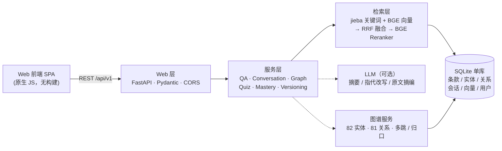

# 校园知识问答系统


基于 **GraphRAG 的校园制度/通知知识问答与学习平台**（图谱增强检索工作流；图谱工具化见「能力边界与路线图」）。核心知识源为学生手册 PDF，融合实体关系图谱，提供带引用的问答、多轮追问、知识图谱探索、校规自测与错题复习、掌握标记。

*A GraphRAG-based campus Q&A system over Chinese university policy PDFs — hybrid retrieval (jieba keywords + BGE embeddings, RRF fusion, BGE reranker), an entity-relation graph, citation-grounded answers with structured refusal, and temporal version control (SUPERSEDES). Built with FastAPI + SQLite.*

> 设计文档：`docs/校园知识问答系统_项目设计文档.md`
> 第一阶段说明：`docs/第一阶段设计说明.md`
> 第二阶段说明：`docs/第二阶段设计说明.md`
> 第三阶段说明：`docs/第三阶段设计说明.md`

## 架构



## 功能

**第一阶段（P0）**
- ✅ PDF 手册解析 → 语义切分（章/条）→ 元数据 → SQLite，幂等导入
- ✅ 关键词/精确检索 + 单轮问答 + 诚实拒答
- ✅ 空问题 / 超长问题 / 数据库不可用等明确提示

**第二阶段（P1 · GraphRAG 与学习闭环）**
- ✅ 向量检索（配置 Embedding API，否则本地确定性向量器兜底）+ 关键词/向量/混合(RRF)检索对比
- ✅ 多轮会话：新建/列表/历史/删除，指代追问（LLM 改写 + 降级拼接）
- ✅ 知识图谱：节点搜索、一/两跳邻居、分类统计、子图导出、SVG 力导向可视化
- ✅ 时效过滤：失效/被替代文档默认不参与检索，SUPERSEDES 冲突提示
- ✅ 自测题库：按分类/难度抽题、判题给解析、错题复习、不重复出题
- ✅ 掌握标记：知识点标记已掌握/未掌握，未掌握项进入问答提示
- ✅ 工程能力：.env 配置（密钥不入库）、结构化日志、健康检查、Swagger、自动化测试
- ✅ 前后端分离：独立 `frontend/` 静态 SPA + FastAPI REST API（CORS）

**第三阶段（P2 · 产品化）**
- ✅ 本地模型接入：`BAAI--bge-small-zh-v1.5` 做 Embedding（512 维）、`BAAI--bge-reranker-base` 做重排序；**三级降级**（本地 BGE → Embedding API → 确定性哈希向量器），且**选型期与运行期两个时机都降级**（向量路异常自动退化为关键词单路，问答不中断）
- ✅ 混合检索 + reranker：关键词 + 向量双路召回 + RRF 融合 + BGE 重排序
- ✅ 质量评测：**55 题**评测集，报告 Recall@K / 事实一致性 / 引用覆盖率（实测 Recall@5 = **0.89~0.90**、事实一致性 = **0.69~0.70**、引用覆盖率 = **100%**；口径与复现方法见「复现评测指标」）
- ✅ 增量入库（老师维护端）：上传通知 → 解析 → SUPERSEDES 自动检测 → 入库
- ✅ 多用户隔离与权限：student / teacher / admin，Token 鉴权，会话/掌握/答题按用户隔离
- ✅ 答案引用全量展开：来源条款 + 关系路径 + 原文片段
- ✅ 容器化：Dockerfile + docker-compose（应用 + nginx 反代）；备份/恢复脚本
- ✅ 平台集成：`/dify/retrieval` 按 Dify External Knowledge API 协议暴露混合检索（默认关闭，配置 `DIFY_RETRIEVAL_API_KEY` 后启用）

## 能力边界与路线图

**已完成**：图谱增强检索（Knowledge-Graph-Enhanced RAG）——在实体关系图上做一/两跳邻居查询、归口识别与引用路径展开；检索侧为 jieba 关键词 + BGE 向量双路召回、RRF 融合、BGE 重排。

**明确不含**（避免夸大）：社区检测与社区摘要——即非微软 GraphRAG 的「Leiden 聚类 + LLM 社区摘要」路线；图谱数据由规则与人工整理，非 LLM 自动抽取。

**路线图**：

- [ ] 图谱能力工具化：把图谱暴露为 `query_graph` 工具，由模型自主决定是否查图谱（当前为固定流水线）
- [ ] 意向路由：在「纯检索 / 图谱多跳 / 拒答」之间做自主决策
- [ ] 扫描版 PDF 的 OCR 入库（当前无文本层时跳过条款写入并给出告警）

> 对外更准确的叫法是「图谱增强的 RAG」；详见《项目设计文档》§0.4「GraphRAG 命名边界」。

## 快速开始

### 1. 环境要求

- Python 3.10+
- （可选）OpenAI 兼容 LLM API（DeepSeek / 智谱 GLM / Qwen / Ollama 等）

### 2. 安装依赖

```bash
python -m pip install -r requirements.txt
```

### 3. 配置

```bash
# 复制并修改（密钥只写在 .env，绝不入库）
copy .env.example .env    # Windows
cp .env.example .env      # Linux/macOS
```

`.env` 关键项（详见 `.env.example`）：

```ini
# LLM（OpenAI 兼容，或 DeepSeek 风格变量名）
LLM_ENABLED=true
LLM_BASE_URL=https://api.deepseek.com/v1
LLM_API_KEY=sk-xxxx
LLM_MODEL=deepseek-chat
# Embedding（可选；不配置则用本地 BGE 或哈希向量器）
EMBEDDING_BASE_URL=
EMBEDDING_API_KEY=
EMBEDDING_MODEL=text-embedding-3-small
# 本地模型（BGE，默认启用 auto）
LOCAL_MODELS_DIR=local_models/models
USE_LOCAL_EMBEDDING=auto
USE_LOCAL_RERANKER=auto
ML_DEVICE=cpu
# Dify 外部知识库（可选；留空 = 不注册 /dify/retrieval）
DIFY_RETRIEVAL_API_KEY=
```

### 4. 导入数据（幂等，可反复执行）

```bash
python -m app.cli import
```

会打印统计与最小规模校验，并构建向量索引。

### 5. 提问

```bash
python -m app.cli ask "奖学金申请需要什么条件？"
python -m app.cli ask "学校校车几点发车？"   # 知识库没有 → 明确拒答
python -m app.cli chat                        # 交互式多轮问答
```

### 6. 前后端分离启动

**后端（REST API + Swagger）**

```bash
python -m app.cli serve --port 8000
# Swagger: http://127.0.0.1:8000/docs
# 健康检查: http://127.0.0.1:8000/api/v1/health
```

**前端（独立静态 SPA，另一个端口）**

```bash
cd frontend
python -m http.server 5500
# 打开 http://127.0.0.1:5500
```

> 也可用仓库自带脚本（**显式禁用缓存**，避免浏览器复用旧 JS/CSS 导致空白页）：
> `python scripts/frontend_server.py` → http://127.0.0.1:5500

前端默认请求同源 `/api/v1`；若同源没有后端（例如用 `python -m http.server` 起前端），会自动探测并回退到 `http://127.0.0.1:8000`。也可用 `http://127.0.0.1:5500/?api=http://你的后端地址` 显式指定。

**前端页面**（左侧导航，按身份显示/放行）

| 页面 | 说明 |
| --- | --- |
| 💬 智能问答 | 会话侧边栏（新建/切换/删除/历史恢复）+ 多轮追问 + 引用溯源 |
| 🕸️ 知识图谱 | 节点搜索、一/两跳邻居、力导向可视化、**关系路径展开** |
| 📝 校规自测 | 按分类/难度抽题、判题解析、错题复习 |
| 🎯 掌握标记 | 知识点标记已掌握/未掌握，未掌握项进入问答提示 |
| ⚖️ 检索对比 | 关键词 / 向量 / 混合(RRF) 三列对比 |
| 🛠️ 维护端 | 增量入库通知（自动 SUPERSEDES）、质量评测、文档时效、用户列表（管理员） |
| ℹ️ 系统信息 | 健康检查、数据统计、时效全景 |

> 左下角可创建/切换身份（学生 / 老师 / 管理员）。会话、掌握标记、答题记录均按身份隔离；
> 维护端与评测接口需要老师或管理员身份。

## API 一览（/api/v1）

| 分组 | 端点 |
| --- | --- |
| 问答 | `POST /ask` |
| 会话 | `POST/GET /sessions`、`GET/DELETE /sessions/{id}`、`GET /sessions/{id}/messages`、`POST /sessions/{id}/ask` |
| 图谱 | `GET /graph/stats`、`/graph/categories`、`/graph/nodes?q=`、`/graph/nodes/{id}/neighbors`、`/graph/subgraph` |
| 自测 | `GET /quiz/categories`、`/quiz/questions`、`/quiz/wrong`、`/quiz/summary`、`POST /quiz/answer` |
| 掌握 | `GET/POST /mastery` |
| 检索 | `GET /search/compare?q=` |
| 时效 | `GET /versioning` |
| 用户 | `POST/GET /users`、`GET /me`（Token 鉴权 `X-User-Token`） |
| 维护 | `POST /ingest/notice`（老师）、`POST /evaluation/run`、`GET /evaluation/latest` |
| 引用 | `GET /graph/paths/{node_id}` |
| 运维 | `GET /health`、`GET /stats` |
| 集成 | `POST /dify/retrieval`（Dify External Knowledge API 协议，默认关闭） |

## 数据说明

```
data/
├── raw/
│   ├── manifest.json           # 文件元数据清单（标题/分类/发文/日期/状态/版本/适用对象）
│   ├── handbook/               # 学生手册（核心知识源；PDF 未随仓库分发，自行放入）
│   └── notices/                # 通知（含 2024/2025 奖学金评定，演示 SUPERSEDES）
├── kg/
│   ├── categories.json         # 主题分类（5 类；其中 2 类有原文文档，其余仅有图谱实体）
│   ├── entities.json           # 实体（部门/流程/领域对象，82 个）
│   └── relations.json          # 关系（81 条，含 SUPERSEDES）
├── faq.json                    # 常见问答（16 组）
├── quiz.json                   # 自测题库（22 题）
└── evaluation.json             # 质量评测集（55 题）
```

### 数据准备

**随仓库分发**：`manifest.json`、`data/kg/`、`faq.json`、`quiz.json`、`evaluation.json`，以及 `notices/` 下的演示样例 —— 克隆后即可查看图谱、FAQ、自测题与评测集。

**需自行准备**（原件版权归校方，未随仓库公开）：

| 文件 | 放入位置 | 作用 |
| --- | --- | --- |
| 学生手册 PDF（`2025版学生手册.pdf`） | `data/raw/handbook/` | 核心知识源：条款切分、检索与引用的主体 |
| 院系综合测评细则 PDF | `data/raw/notices/` | 补充通知类知识（可选） |

`manifest.json` 已声明各文件应处的相对路径与元数据，**文件名与目录需与清单一致**，放好后执行 `python -m app.cli import` 即可建库。若某条目对应的文件缺失，导入会明确报错（`原始文件不存在: <相对路径>`），不会静默跳过。

> **重要**：`data/kg`、`faq.json`、`quiz.json` 为人工整理的示例数据（符合设计文档"人工校验"要求）。通知文本为演示用的样例，正式上线须替换为学校官方文件并逐条校验。

## 复现评测指标

评测依赖两个本地 BGE 模型（体积大，未随仓库分发，需自行下载）：

```bash
pip install sentence-transformers

# 目录名需与项目约定一致：local_models/models/BAAI--<模型名>
huggingface-cli download BAAI/bge-small-zh-v1.5 \
  --local-dir local_models/models/BAAI--bge-small-zh-v1.5
huggingface-cli download BAAI/bge-reranker-base \
  --local-dir local_models/models/BAAI--bge-reranker-base
```

`.env` 保持 `USE_LOCAL_EMBEDDING=auto`、`USE_LOCAL_RERANKER=auto`，然后建库并启动服务：

```bash
python -m app.cli import                 # 建库 + 构建向量索引（首次约 18s）
python -m app.cli serve --port 8000      # 启动 REST 服务
curl -X POST http://127.0.0.1:8000/api/v1/evaluation/run -H "X-User-Token: <teacher-token>"
```

**期望结果**（55 题评测集，CPU 环境）：

| 指标 | 期望值 | 说明 |
| --- | --- | --- |
| Recall@5 | **0.89 ~ 0.90** | 双路召回（jieba 关键词 + BGE 向量，RRF 融合）后接 BGE 重排 |
| 事实一致性 | **0.69 ~ 0.70** | 离线近似指标：题目关键词在检索内容中的命中率 |
| 引用覆盖率 | **1.00** | 有检索结果必带可溯源引用 |

> 未下载本地模型时，Embedding 会自动降级为确定性哈希向量器，指标会明显下降——这是设计内的三级降级行为（本地 BGE → Embedding API → 哈希向量器），不代表检索链路失效。
> 另：CLI 目前只有 `import / stats / ask / chat / serve`，触发评测走上面的 REST 接口。

## 测试

```bash
python -m pytest -v
```

67 个测试（66 通过 + 1 跳过）覆盖：AT-01（幂等+最小规模）、AT-02（回答+引用）、AT-03（拒答）、AT-04（多轮指代）、AT-05（图谱邻居）、AT-06（自测错题）、AT-07（掌握标记）、AT-08（非法输入/不可用）、**AT-09（Embedding 降级）**、AT-11（时效替代），以及向量/混合/检索对比（P1）、本地模型接入/reranker/增量入库/多用户隔离/评测/引用路径（P2）、权限边界（403 与用户创建 bootstrap）。

> 测试默认 `USE_LOCAL_* = off`（哈希向量器）以加速；本地模型推理在第三阶段已单独实测（BGE 512 维、reranker 排序正确）。

**CI**：`.github/workflows/ci.yml` 在 push / PR 时自动运行（Python 3.10 + 3.12），负责**不依赖原始语料**的那部分质量门禁：前端脚本语法检查、`data/**/*.json` 完整性、后端应用装配冒烟，以及 6 个语料无关用例（含评测集规模与 Embedding 降级链）。

> 完整 67 项测试依赖 `data/raw/` 下的原始语料（学生手册 PDF 等，依版权未入库），因此无法在 CI 中运行——请在本地放好原始文件与 BGE 模型后执行 `python -m pytest -q`。

## 目录结构

```
app/
├── config.py        # .env（UTF-8/GBK 自动识别）/ 环境变量，兼容 DeepSeek 变量名
├── errors.py        # 统一错误类型与中文提示
├── db.py            # SQLite 存储层（节点/关系/条款/会话/向量/掌握/答题/用户/评测）
├── embeddings.py    # Embedding：本地 BGE → API → 哈希向量器（三级降级）
├── ml_local.py      # 本地 BGE 模型加载/推理（惰性加载 + 快照目录解析）
├── logging_util.py  # 结构化日志（request_id/session_id/耗时）
├── backup.py        # 备份/恢复（SQLite backup API）
├── ingest/          # parser(章/条切分) + importer(幂等) + stats(规模校验)
├── retrieval/       # tokenizer + search(关键词) + vector(向量) + hybrid(RRF+reranker)
├── service/         # qa(GraphRAG) + llm + conversation + graph + quiz + mastery
│                    # + versioning + users + ingestion + evaluation + paths
├── web/             # FastAPI REST（前后端分离，CORS）
└── cli.py           # import / stats / ask / chat / serve
frontend/            # 独立静态 SPA（问答/图谱/自测/掌握/检索对比/维护端/系统信息 + 身份切换）
local_models/        # 本地 BGE 模型（gitignore，部署时挂载卷）
deploy/              # nginx 反向代理配置
docs/                # 项目设计文档 + 第一/二/三阶段设计说明（索引见 docs/README.md）
scripts/             # 本地工具（frontend_server.py：禁用缓存的静态服务器）
tests/               # pytest 测试（67 个）
.github/workflows/   # CI（push / PR 自动运行）
Dockerfile
docker-compose.yml
CHANGELOG.md

## 常见故障

| 现象 | 处理 |
| --- | --- |
| `知识库连接失败` | 先执行 `python -m app.cli import` 导入数据 |
| 回答显示"混合检索"（原文摘编） | 未配置 LLM 或调用失败（正常降级）；检查 `.env` 的 LLM_API_KEY 与网络 |
| 前端请求失败 | 确认后端已启动且 CORS_ORIGINS 允许前端来源；或用 `?api=` 指定后端地址 |
| PDF 导入后条款为空 | 可能是扫描版 PDF（无文本层）；OCR 属后续阶段，当前以 FAQ/图谱数据保障演示 |
| 向量检索结果与关键词差异大 | 未配置真实 Embedding 时使用本地哈希向量器，语义能力有限；配置 EMBEDDING_API_KEY 后质量显著提升 |
