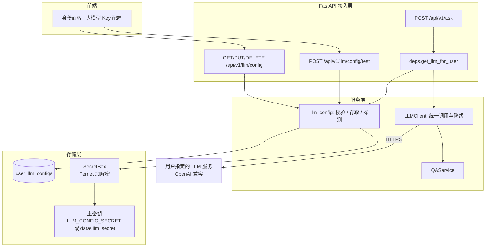
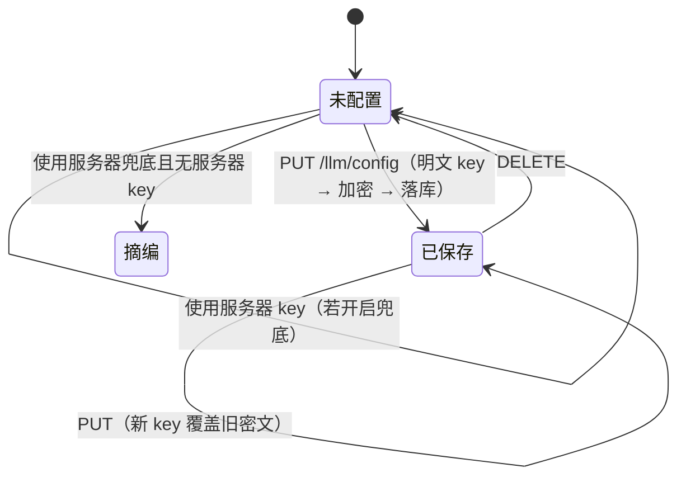

# 用户自带大模型密钥（BYOK）设计与实现

> 面向"把系统推广给其他人用"的场景。当前实现里大模型走的是部署者自己的
> `DEEPSEEK_API_KEY`，一旦开放给外部用户，等于让陌生人花你的钱，且无法按用户限流。
> 本方案要求每个用户配置自己的 API Key 与 Base URL，费用与额度各自承担。

## 1. 问题定义

### 1.1 为什么不能继续共用一把 key

| 风险 | 说明 |
|---|---|
| 成本不可控 | 任何人拿到访问地址就能无限提问，Token 消耗由部署者买单 |
| 无法归因 | 出问题时不知道是谁在跑，日志里只有一个全局 key |
| 连带封禁 | 单个用户违规调用可能导致整把 key 被上游停用，所有人一起挂 |
| 额度共享 | 高峰期互相抢配额，先来先得，用户体验不稳定 |

### 1.2 目标与非目标

**目标**

1. 用户可自助填写 `api_key` / `base_url` / `model`，保存后立即对该用户的问答生效；
2. 密钥加密落库，任何接口都不返回明文，日志不出现明文；
3. 用户之间严格隔离，A 的配置不影响 B；
4. 用户没配置时，行为可配置：要么借用服务器 key，要么明确降级为"原文摘编"；
5. 提供"测试连通性"，让用户在保存前就知道 key / 地址 / 模型是否匹配。

**非目标**

- 不做密钥的托管与代充值（那属于计费系统，不是本项目范围）；
- 不做多 key 轮询与负载均衡（单用户单 key 已足够，多 key 会引入选择策略与失败转移的复杂度）；
- 不做前端本地加密（浏览器端加密无法防住 XSS，反而给人虚假的安全感）。

## 2. 五要素

| 要素 | 内容 |
|---|---|
| 目标 | 把"用谁的 key"从全局配置变为按用户解析 |
| 输入 | 用户提交的 `api_key` / `base_url` / `model`（HTTP 请求体） |
| 输出 | 问答链路使用该用户的模型；接口只回掩码与状态 |
| 成功指标 | 配置保存成功率 ≥ 99%；明文 key 在响应/日志/库文件中出现次数 = 0；跨用户读取 = 0 |
| 约束 | 单库 SQLite、无外部密钥服务；不引入新的运行时依赖（仅加 `cryptography`） |
| 风险 | 主密钥泄露 = 全部用户 key 泄露；base_url 可被用于 SSRF；用户填错模型名导致频繁失败 |

## 3. 架构



### 3.1 为什么按请求解析，而不是启动时装配

`QAService` 是应用级单例（里面还挂着 BGE 模型，不能按请求重建）。因此**只把 LLM 客户端做成请求级**：
`deps.get_llm_for_user` 每次请求读一次配置、构造一个 `LLMClient`，再显式传给 `qa.ask(llm=...)`。

代价是每个请求多一次 SQLite 单行查询 + 一次 Fernet 解密（微秒级）；换来的是"改完立即生效"，
不需要重启服务，也不会出现缓存脏读导致"我明明换了 key 还在用旧的"。

### 3.2 组件职责

| 组件 | 职责 | 输入 | 输出 | 失败处理 |
|---|---|---|---|---|
| `app/crypto.py` | 主密钥加载、加解密、掩码 | 明文字符串 | Fernet 密文 / 明文 / `sk-…abcd` | 解密失败按"未配置"处理，记 WARNING |
| `app/service/llm_config.py` | 校验、CRUD、连通性探测、输出视图 | 请求体 + 用户 ID | 掩码视图 / 测试结果 | 校验失败抛 400；探测失败返回结构化原因 |
| `app/service/llm.py` | 统一请求、重试、脱敏 | 问题 + 证据 | 回答文本 | 抛 `LLMUnavailable`，QA 层降级摘编 |
| `deps.get_llm_for_user` | 决定用谁的 key | 当前用户 | `LLMClient` | 无可用配置时返回"不可用客户端" |

## 4. 数据模型

```sql
CREATE TABLE IF NOT EXISTS user_llm_configs (
    user_id     TEXT PRIMARY KEY,              -- 与 users.user_id 对齐；匿名不落库
    base_url    TEXT NOT NULL DEFAULT '',      -- 已规范化，末尾不带 /chat/completions
    model       TEXT NOT NULL DEFAULT '',
    api_key_enc TEXT NOT NULL DEFAULT '',      -- Fernet 密文
    key_hint    TEXT NOT NULL DEFAULT '',      -- 仅首 3 位 + 末 4 位，用于辨认
    enabled     INTEGER NOT NULL DEFAULT 1,
    created_at  TEXT NOT NULL DEFAULT (datetime('now', 'localtime')),
    updated_at  TEXT NOT NULL DEFAULT (datetime('now', 'localtime'))
);
```

设计说明：

- **一张表一个用户一行**：不保留历史版本。轮换 key 直接覆盖，避免旧 key 长期留在库里；
- **不存 user_id 外键约束**：用户删除时配置应一并清理，但当前 users 表没有删除接口，
  加 `REFERENCES` 反而会因历史数据留下悬空行。清理放在删除用户的接口里做（后续项）；
- **`enabled` 而非软删除**：用户想临时停用但保留配置时不必重填。

## 5. 密钥生命周期



关键点：

1. **明文只在请求体与内存里出现**：`PUT` 请求体经 Pydantic 校验后立刻加密，之后不再外传；
2. **写入用 upsert**：`ON CONFLICT(user_id) DO UPDATE`，避免并发下先删后插出现空窗；
3. **读失败不崩**：主密钥换过 → `Fernet` 抛 `InvalidToken` → 记日志并当作"未配置"，用户重填即可；
4. **删除即物理删除**：不留"已删除但可恢复"的密文副本。

## 6. API 契约

### 6.1 `GET /api/v1/llm/config`

匿名可读（前端要能提示"去登录才能配"）。

```json
{
  "configured": true,
  "enabled": true,
  "base_url": "https://api.deepseek.com/v1",
  "model": "deepseek-chat",
  "key_hint": "sk-…9876",
  "updated_at": "2026-10-28 09:20:11",
  "source": "user",
  "server_fallback": true,
  "effective": true
}
```

| 字段 | 含义 |
|---|---|
| `source` | `user` 个人配置 / `server` 服务器兜底 / `none` 都没有 |
| `effective` | 是否真的会有大模型参与生成（false 表示只能原文摘编） |
| `server_fallback` | 服务端是否开启兜底（部署方决定，用户不可改） |

### 6.2 `PUT /api/v1/llm/config`

请求体：

```json
{
  "api_key": "sk-xxxxxxxx",
  "base_url": "https://api.deepseek.com/v1",
  "model": "deepseek-chat",
  "enabled": true
}
```

- `api_key` 留空 = 沿用已存的 key（只改模型/地址时不必重填）；
- `base_url` 留空 = 沿用已存值，首次则取服务端默认；
- 首次配置且 key 为空 → `400`。

### 6.3 `POST /api/v1/llm/config/test`

带 key 则测这份"还没保存"的配置，不带则测已保存的。

```json
{ "ok": true, "latency_ms": 812, "model": "deepseek-chat", "message": "连接成功" }
```

失败示例：`{"ok": false, "message": "认证失败（401）：API Key 无效或已过期"}`。

限频：同一用户 `LLM_CONFIG_TEST_INTERVAL` 秒内只能测一次（默认 5 秒，返回 `429`）。

### 6.4 `DELETE /api/v1/llm/config`

`{"deleted": true}`。重复删除返回 `{"deleted": false}`，不报错。

## 7. 降级矩阵

| 用户配置 | 服务器兜底 | 服务器 key | 实际结果 |
|---|---|---|---|
| 有且 enabled | — | — | 用用户 key，`source=user` |
| 有但 enabled=false | 开 | 有 | 用服务器 key，`source=server` |
| 有但 enabled=false | 开 | 无 | 原文摘编，`effective=false` |
| 无 | 开 | 有 | 用服务器 key，`source=server` |
| 无 | 开 | 无 | 原文摘编 |
| 无 | 关 | — | 原文摘编，`source=none` |

"原文摘编"是项目既有能力：直接拼接命中的条款原文，并在开头声明"未启用大模型生成"。
它不是错误态，用户仍能看到有出处的答案。

## 8. 错误矩阵

| 场景 | HTTP | code | 用户可见文案 | 处理 |
|---|---|---|---|---|
| 匿名调用写接口 | 403 | `FORBIDDEN` | 请先创建或登录身份 | 前端引导登录 |
| key 太短 / 含空格 | 400 | `INVALID_INPUT` | API Key 太短/含空格 | 拦在保存前 |
| base_url 非 http(s) | 400 | `INVALID_INPUT` | 必须以 http(s) 开头 | 拦在保存前 |
| base_url 指向内网 | 400 | `INVALID_INPUT` | 不能指向本机或内网地址 | 拦在保存前 |
| 首次保存未填 key | 400 | `INVALID_INPUT` | 首次配置必须填写 API Key | 拦在保存前 |
| 测试过于频繁 | 429 | `RATE_LIMITED` | 请 N 秒后再试 | 前端禁用按钮 |
| 上游 401 | 200 | — | 认证失败：Key 无效或过期 | 作为测试结果返回，不抛异常 |
| 上游超时 | 200 | — | 连接超时：检查地址/网络 | 同上 |
| 调用失败（问答链路） | 200 | — | 自动降级为原文摘编，`degraded=true` | 不让整条问答失败 |

## 9. 安全清单

| 威胁 | 对策 | 残余风险 |
|---|---|---|
| 数据库泄露 | 密文落库 + 主密钥分离（env） | 主密钥与库同机时仍可被同时窃取 |
| 日志泄露 | 只记 `key_hint`，异常文本脱敏 | 上游返回体若回显 key（极少见）需靠脱敏兜底 |
| 接口泄露 | 响应永不包含明文；前端不落 localStorage | 浏览器 DevTools 可见请求体（用户自己的机器，可接受） |
| SSRF | 禁私网/回环/链路本地 + 禁用户名密码 | DNS 重绑定可绕过，需出站策略兜底 |
| 越权读取 | 所有读写以 `user["user_id"]` 为键 | 拿到别人 Token 即可冒用（Token 机制本身的局限） |
| 暴力测试 | 测试接口按用户限频 | 多账号轮换可绕过 |
| 主密钥丢失 | 解密失败降级为"未配置" | 用户需重填一次 |

**部署必做两件事**（否则安全性打折）：

1. 设置 `LLM_CONFIG_SECRET`，不要依赖自动生成的 `data/.llm_secret`；
2. 设置 `ALLOW_SERVER_LLM_FALLBACK=false`，避免被白嫖。

## 10. 关键取舍

| 决策 | 选择 | 放弃的方案 | 理由 |
|---|---|---|---|
| 加密方式 | Fernet（AES-128-CBC + HMAC） | 明文 / 哈希 / 自研异或 | key 要能还原去调用，哈希不可行；自研密码学是负债 |
| 主密钥来源 | env 优先，文件兜底 | 只允许 env | 只允许 env 会让本地跑不起来，抬高试用门槛 |
| 解析时机 | 每请求解析 | 启动时装配 / 长缓存 | 单例装配无法按用户区分；长缓存会让改 key 不生效 |
| base_url 校验 | 协议 + 私网字面量 | 不校验 / 全量 DNS 校验 | 不校验等于开放 SSRF；DNS 校验有 TOCTOU 且增加每次请求延迟 |
| 测试接口 | 真实调用一次 | 只做格式校验 | 格式对但 key 错是最常见的失败，必须真打一次 |
| 匿名配置 | 拒绝 | 允许并存到 localStorage | 匿名没有稳定 user_id，配置会"看起来保存了其实没用" |

## 11. 部署与迁移

1. `pip install -r requirements.txt`（新增 `cryptography>=42`）；
2. 设置环境变量：

```bash
LLM_CONFIG_SECRET=<32 字节以上的随机串>
ALLOW_SERVER_LLM_FALLBACK=false   # 推广时关掉，避免共用运营方 key
ALLOW_PRIVATE_LLM_BASE_URL=false  # 除非确实要接内网网关
```

3. 重启服务。`init_schema` 会用 `CREATE TABLE IF NOT EXISTS` 建表，**无需手工迁移**，
   已有数据不受影响；
4. 回滚：把代码退回到上一个 tag 即可。新表留着不碍事（旧代码不读它），
   用户下次仍会走服务器 key 逻辑。

## 12. 验证

```bash
# 单元与接口测试（10 条，不依赖任何真实 key）
python -m pytest tests/test_llm_config.py -q
```

覆盖：匿名拒绝、掩码输出、明文不落库、跨用户隔离、URL 校验、留空沿用、删除幂等、兜底开关。

真实环境冒烟（需要一把真 key）：

```bash
TOKEN=<登录后的 api_token>
curl -X PUT http://127.0.0.1:8000/api/v1/llm/config \
  -H "X-User-Token: $TOKEN" -H 'Content-Type: application/json' \
  -d '{"api_key":"sk-...","base_url":"https://api.deepseek.com/v1","model":"deepseek-chat"}'

curl -X POST http://127.0.0.1:8000/api/v1/llm/config/test \
  -H "X-User-Token: $TOKEN" -H 'Content-Type: application/json' -d '{}'
```

## 13. 未覆盖的风险（后续项）

1. **额度耗尽无预警**：目前只有调用失败后降级，没有"本月剩余额度"提示；
2. **多 key 轮换**：用户换 key 需手动重填，没有多 key 容灾；
3. **审计粒度**：只记了保存/测试事件，没有按次记录消耗的 token 数；
4. **模型白名单**：用户可填任意模型名，错误配置会在真实问答时才暴露（测试接口能提前发现，但非强制）。
